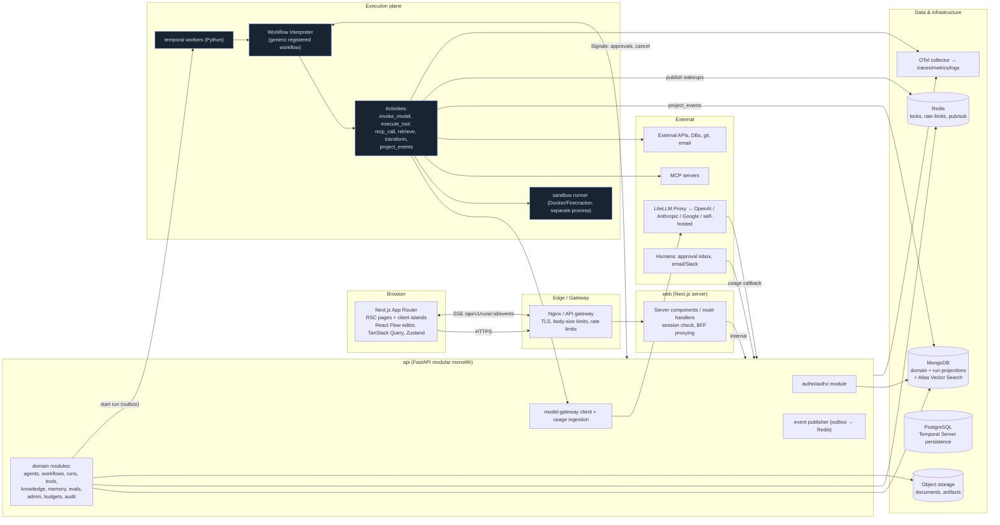
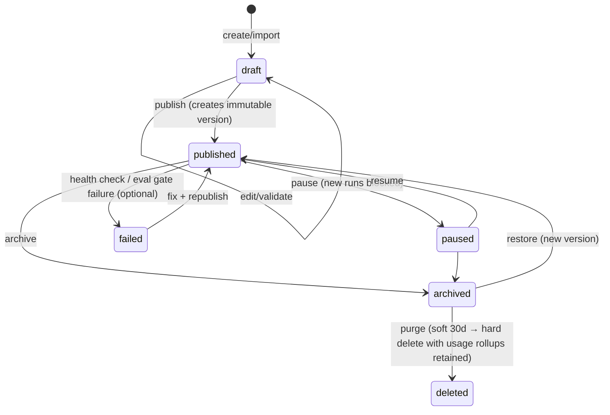
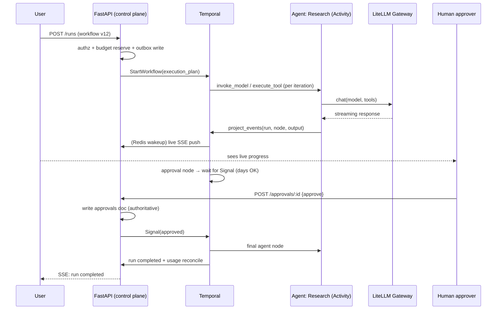
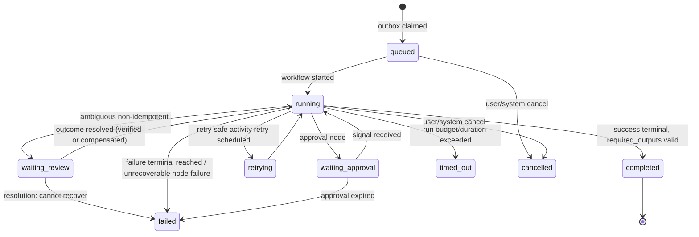
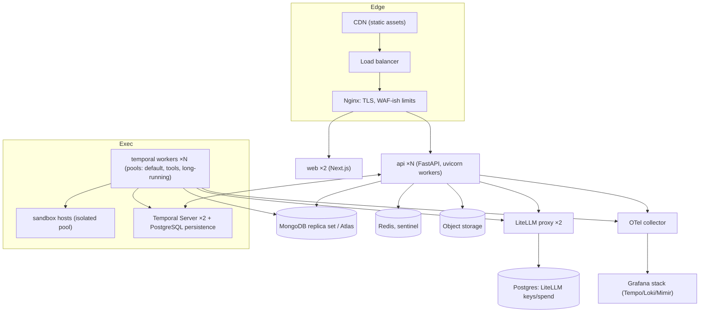

# Enterprise AI Orchestration Platform — Engineering Blueprint

**Version:** 1.0-draft · **Date:** October 27, 2026 · **Status:** Engineering specification (not a marketing document)

This blueprint specifies a production-oriented AI orchestration platform ("the Platform") built on Next.js (App Router) + TypeScript, FastAPI + Python, MongoDB (primary application database), Redis, Temporal (durable execution), and object storage. It is written to be implementable by a skilled full-stack team, with explicit contracts, state machines, and a phased roadmap. All third-party capability claims are cited; platform APIs described here are **proposed** and labeled as such.

---

## 1. Executive Summary

The Platform is a multi-tenant operating system for AI agents: users create and version agents, compose them into workflows on a visual canvas, connect models through a unified gateway, attach tools (HTTP, MCP, code, databases), ground them in knowledge bases, and monitor every execution with full traces, budgets, and approval gates.

The five load-bearing architectural decisions, each justified in §5:

1. **Temporal owns durable execution.** The Platform's workflow DSL (JSON graphs stored in MongoDB) is interpreted by a generic, registered Temporal Workflow; nodes execute as Temporal Activities; human approvals wait on Temporal Signals. Temporal's documented guarantees — workflows resume automatically after a crash or a multi-day human-approval wait ([Temporal Durable AI docs](https://docs.temporal.io/ai), [How Temporal Works](https://temporal.io/how-it-works)) — make it the execution backbone rather than a hand-rolled queue.
2. **PydanticAI provides typed agent-loop construction; Temporal owns the loop.** The interpreter Workflow drives each agent's bounded loop; every model call (`invoke_model`) and tool execution (`execute_tool`) is a separate durable Activity ([PydanticAI overview](https://pydantic.dev/docs/ai/overview/), [Temporal integration](https://pydantic.dev/docs/ai/capabilities/durable_execution/temporal/)). LangGraph is deliberately excluded from the baseline to avoid two competing graph runtimes (§5.4).
3. **LiteLLM is the model gateway.** Its proxy provides routing, load balancing, fallbacks, retries, and per-key/team/user rate limits ([Life of a Request](https://docs.litellm.ai/docs/proxy/architecture), [Fallbacks](https://docs.litellm.ai/docs/proxy/reliability), [Load Balancing](https://docs.litellm.ai/docs/proxy/load_balancing)). The Platform keeps budget, authorization, and audit ownership in its own services.
4. **MongoDB is the primary application database and read projection for execution.** Definitions, versions, permissions, run records, and searchable events live in MongoDB; Temporal is the authority for in-flight execution state; Redis is ephemeral; object storage holds artifacts ([Temporal persistence](https://docs.temporal.io/temporal-service/persistence)).
5. **A modular monolith first.** One FastAPI app with strict module boundaries, plus separate worker processes for Temporal workers and sandboxes. Microservices are deferred until scaling demands them.

The MVP is a vertical slice: auth → one agent → a JSON-defined workflow with one conditional branch and one approval gate → durable execution → live run monitoring → budget enforcement → forced-restart recovery test. The visual editor, MCP catalog, RAG, and evaluation suite follow once the execution engine is proven reliable.

---

## 2. Product Scope and Core Use Cases

### 2.1 Core use cases

| # | Use case | Primary actors | Critical path |
|---|---------|----------------|---------------|
| UC-1 | Author and version an agent | Agent builder | Agent studio → validation → publish immutable version |
| UC-2 | Compose a multi-agent workflow visually | Workflow builder | Canvas editor → typed edges → validate → publish version |
| UC-3 | Execute a workflow and watch it live | Operator | Trigger (manual/API/schedule/webhook) → run page with live node states |
| UC-4 | Approve a sensitive action | Human approver | Approval inbox → decision recorded → workflow resumes |
| UC-5 | Ground agents in documents | Knowledge manager | Upload → parse → chunk → embed → permission-aware retrieval |
| UC-6 | Register a tool/integration | Admin, developer | Tool registry → schema → risk class → approval policy |
| UC-7 | Compare models and agent versions | Evaluator | Dataset → experiment → report with pass/fail metrics |
| UC-8 | Control spend | Platform admin, finance | Budget policy → reservation → reconciliation → alerts |
| UC-9 | Investigate a failed run | Engineer | Trace viewer → node I/O → tool calls → retry history |
| UC-10 | Audit and govern | Security officer | Audit log → policy config → retention settings |

### 2.2 Explicit non-goals (v1)

- Not a consumer chatbot product; the chat surface is a debugging/test harness for agents, not the product.
- Not a general-purpose low-code integration platform (n8n replacement); AI orchestration is the center.
- No autonomous cross-workspace agent collaboration; agents never cross tenant boundaries.
- No training or fine-tuning of models; inference only.
- No promise of perfect prompt-injection defense (§16.8 states residual risks).

### 2.3 Personas

- **Builder** — creates agents, workflows, tools; needs testing sandboxes and versioning.
- **Operator** — runs workflows, handles approvals, watches live executions.
- **Knowledge manager** — manages document collections and retrieval quality.
- **Admin** — manages members, roles, providers, secrets, policies, budgets.
- **Security/audit officer** — read-only audit, policy review, retention.

---

## 3. Current Technology Research

Research date: October 2026. Capabilities below are verified against the cited official documentation; anything not verifiable is marked *assumption* or *unknown*.

### 3.1 Durable execution engines

**Temporal** is a workflow orchestration platform whose core guarantee is "durable execution" — code that "runs to completion no matter what," with workflow replay as the mechanism that lets a workflow resume after process crashes ([How Temporal Works](https://temporal.io/how-it-works), [Durable Execution tutorial](https://learn.temporal.io/tutorials/python/background-check/durable-execution/)). The Durable AI documentation states that a workflow "resumes automatically after a crash, a network timeout, or a multi-day wait for a human to approve a step," that agent loops pick up where they left off, and that approvals are captured via Signals ([Temporal Durable AI](https://docs.temporal.io/ai)). Temporal markets an AI/agent solution set explicitly ([Temporal AI solutions](https://temporal.io/solutions/ai)) and publishes a LangGraph plugin adding durable execution to LangGraph apps ([Temporal blog](https://temporal.io/blog/temporal-langgraph-plugin-durable-execution)). The Python SDK is actively maintained; Standalone Activities for durable job processing reached GA across SDKs in September 2026 ([Python SDK changelog](https://temporal.io/changelog/product-area/python-sdk)).

Operational requirements: a self-hosted Temporal Service "requires a database such as Apache Cassandra, MySQL, or PostgreSQL" ([deploying docs](https://docs.temporal.io/tags/temporal-service)); the persistence store is the database the Temporal Server uses for event history ([Persistence](https://docs.temporal.io/temporal-service/persistence)). For development, Temporal can be embedded as a Go library / run via docker-compose ([Embedded server](https://docs.temporal.io/self-hosted-guide/embedded-server)). **Implication:** Temporal introduces one additional operational database (PostgreSQL in our deployment) that is *not* the application database — this is stated openly in §7.4.

**LangGraph** provides checkpointers that "save graph state as checkpoints at each super-step, organized into threads," enabling persistence, human-in-the-loop, and fault tolerance ([Checkpointers](https://docs.langchain.com/oss/python/langgraph/checkpointers), [Persistence](https://docs.langchain.com/oss/python/langgraph/persistence)). LangGraph's durable behavior "depends on how you model tasks, side effects, and thread identity" — it is checkpointing, not event-history replay with a separate deterministic runtime ([Cordum comparison](https://cordum.io/blog/temporal-vs-langgraph)). **Decision:** use LangGraph only as an optional future extension for in-activity agent subgraphs, not as the Platform's workflow engine (§5.4).

### 3.2 Agent frameworks

**PydanticAI** is a typed agent framework: "a typed, extensible agent loop with every model a string swap away," running "behind a web frontend, in the terminal... on a durable background queue" ([overview](https://pydantic.dev/docs/ai/overview/)). It has type-safe dependency injection for instructions, tools, and output validators ([Dependencies](https://pydantic.dev/docs/ai/core-concepts/dependencies/)), supports structured output validation, and — critically — documents native Temporal integration: "Attach `TemporalDurability` and the same agent runs inside a Temporal workflow under durable execution: every model and tool call becomes a durable activity" ([overview](https://pydantic.dev/docs/ai/overview/), [Temporal integration](https://pydantic.dev/docs/ai/capabilities/durable_execution/temporal/)). Its durable-execution guidance recommends durable execution "when a workflow waits hours or days for a person" ([Durable Execution](https://pydantic.dev/docs/ai/capabilities/durable_execution/overview/)). **Decision:** PydanticAI is the agent-loop library; §13.2 defines the exact activity boundary.

### 3.3 Model gateways

**LiteLLM Proxy** is a gateway whose request pipeline includes global/virtual-key/user/team rate limiting before the router handles "Load balancing, Fallbacks, Retries" ([Life of a Request](https://docs.litellm.ai/docs/proxy/architecture)). Fallbacks are automatic provider failover after retries ([Fallbacks](https://docs.litellm.ai/docs/proxy/reliability)), including context-window-exceeded-aware fallback; load balancing distributes across deployments of the same model with strategies such as usage-based routing ([Load Balancing](https://docs.litellm.ai/docs/proxy/load_balancing)). Production deployment requires PostgreSQL for the proxy's authentication and tracking features (keys, teams, users, spend logs, configuration) and Redis once more than one proxy instance runs (rate limiting, router state, caching); provider credentials stored in the database are encrypted with `LITELLM_SALT_KEY`, which must never change after models are added ([Production deployment](https://docs.litellm.ai/docs/proxy/deploy)). Some features (e.g., GCS log storage) require an Enterprise license ([Logging](https://docs.litellm.ai/docs/proxy/logging.md)). **Implications:** the proxy adds its own PostgreSQL (keys/spend tracking; we use only open features and re-verify licensing per feature at adoption time); the Platform remains the system of record for budgets, permissions, and audit, using LiteLLM's API for key management and its callback/webhook for usage ingestion.

### 3.4 Tool integration — MCP

The Model Context Protocol is a JSON-RPC 2.0 protocol with lifecycle management, capability negotiation, and an authorization framework for HTTP-based transports ([MCP spec 2026-07-28 overview](https://modelcontextprotocol.io/specification/2026-07-28/basic)). As of revision 2026-07-28 the protocol is **stateless**: servers must not rely on prior requests over the same connection; requests carry required `_meta` (protocol version, client capabilities), and state spanning requests must be referenced by explicit client-supplied identifiers ([Basic spec](https://modelcontextprotocol.io/specification/2026-07-28/basic)). Two transports are defined — stdio (newline-delimited JSON-RPC over a client-launched subprocess's streams) and Streamable HTTP (each message an HTTP POST to a single endpoint, replies as a JSON object or a request-scoped SSE stream); protocol metadata lives in message-body fields, and cancellation is transport-specific (Streamable HTTP cancels by closing the request's response stream) ([Transports](https://modelcontextprotocol.io/specification/2026-07-28/basic/transports.md)). Authorization is optional: when supported, HTTP implementations use OAuth 2.1 with the MCP server as resource server, client-ID discovery via Metadata Documents (Dynamic Client Registration deprecated), and mandatory Resource Indicators ([Authorization](https://modelcontextprotocol.io/specification/2026-07-28/basic/authorization)); STDIO servers retrieve credentials from the environment instead. **Implications:** the Platform's MCP client implements the stateless 2026-07-28 request metadata, treats MCP server responses as untrusted data, and stores explicit task/thread identifiers client-side.

### 3.5 Knowledge retrieval

**MongoDB Atlas Vector Search** provides semantic vector search "alongside your other MongoDB data," with hybrid (semantic + full-text) search and filtering ([Vector Search overview](https://www.mongodb.com/docs/vector-search/), [product page](https://www.mongodb.com/products/platform/atlas-vector-search)). Queries use the `$vectorSearch` operator performing ANN/ENN search with optional MQL pre-filters; metadata fields used in filters must be indexed ([vectorSearch operator](https://www.mongodb.com/docs/search/query/operators-collectors/vectorsearch), [pre-filtering](https://www.mongodb.com/docs/atlas/ai-integrations/llamaindex/)). **Decision:** Atlas Vector Search for the default deployment; a pluggable `RetrievalProvider` interface keeps self-hosted deployments able to substitute alternatives (e.g., a separate vector DB) without redesign (§17).

### 3.6 Sandboxed execution

**E2B** provides isolated Linux machines per agent session — Firecracker microVMs — deployable as managed cloud, in your own cloud, or self-hosted ([e2b.dev](https://e2b.dev/), [sandbox comparison](https://e2b.dev/resources/best-code-execution-sandboxes-for-ai-agents), [coding agents docs](https://docs.e2b.dev/use-cases/coding-agents)). **Decision:** the Platform defines a `SandboxProvider` interface with two implementations: (a) self-hosted Docker/Firecracker workers for on-prem, (b) E2B-compatible cloud sandboxes. Untrusted code never runs in the FastAPI process (§16.5).

### 3.7 Frontend platform

**React Flow** (xyflow) is the mature React library for node-based editors, with keyboard accessibility, and ships an official Next.js Workflow Editor template styled with shadcn/ui ([reactflow.dev](https://reactflow.dev/), [Workflow Editor template](https://reactflow.dev/ui/templates/workflow-editor)). **shadcn/ui** is a code-distribution component system built on Tailwind CSS and Radix UI primitives, now also supporting Base UI, with accessible chart components ([shadcn/ui](https://ui.shadcn.com/llms.txt), [Chart](https://ui.shadcn.com/docs/components/radix/chart)); as of July 2026, new projects default to Base UI with Radix still fully supported ([changelog](https://ui.shadcn.com/docs/changelog/2026-07-base-ui-default)). **Decision:** shadcn/ui (Base UI default) + React Flow + TanStack Query + Zustand + Recharts (via the shadcn chart wrapper) + Zod.

### 3.8 Observability

OpenTelemetry has Generative AI semantic conventions — spans for LLM calls, embeddings, retrievals, tool execution, and agent/framework operations — currently at *Development* status ([GenAI spans](https://github.com/open-telemetry/semantic-conventions-genai/blob/main/docs/gen-ai/gen-ai-spans.md), [agent spans](https://github.com/open-telemetry/semantic-conventions-genai/blob/main/docs/gen-ai/gen-ai-agent-spans.md), [semconv index](https://opentelemetry.io/docs/specs/semconv/)). **Decision:** emit OTel spans following these conventions (gen_ai.* attributes) from the model gateway shim and tool runtime; send to an OTLP endpoint (Grafana stack or a SaaS APM). The conventions are still developing — the Platform treats attribute names as an internal mapping layer.

### 3.9 Provider capabilities (verified examples)

OpenAI documents Structured Outputs ("ensures the model will always generate responses that adhere to your supplied JSON Schema") and function calling ([Structured Outputs](https://platform.openai.com/docs/guides/structured-outputs), [Function calling](https://platform.openai.com/docs/guides/function-calling/introduction)). Anthropic documents tool use ("tool use (also called function calling) lets Claude call functions that you define") with a defined tool-use contract ([Claude tool use](https://platform.claude.com/docs/en/agents-and-tools/tool-use/overview), [how tool use works](https://platform.claude.com/docs/en/agents-and-tools/tool-use/how-tool-use-works)). Google documents Gemini structured outputs (including model-family restrictions — e.g., combining structured outputs with built-in tools limited to newer model series) and function calling ([Gemini structured outputs](https://ai.google.dev/gemini-api/docs/structured-output/), [Gemini function calling](https://ai.google.dev/gemini-api/docs/generate-content/function-calling)). These verified differences — per-provider, per-model capability boundaries — are exactly why the gateway's capability registry (§15.5) is mandatory: gateway normalization does not make the underlying models equivalent.

---

## 4. Competitive Capability Comparison

Comparison of the platform class the Product sits in. "✓" = documented; "?" = not verified in official docs (treated as unknown, not absent).

| Capability | Azure AI Foundry Agent Service | Dify | n8n | LangGraph (+ Platform) | This Platform (proposed) |
|---|---|---|---|---|---|
| Managed runtime, session isolation | ✓ ([overview](https://learn.microsoft.com/en-us/azure/ai-foundry/agents/overview)) | ? | ? | ? (Platform is paid/commercial; not verified) | ✓ self-hosted, Temporal workers |
| Visual workflow builder | Partial (workflow agents preview, [Foundry docs](https://learn.microsoft.com/en-us/azure/foundry/agents/overview?view=foundry-classic)) | ? | ? | ✗ (code-first) | ✓ (core feature) |
| Durable execution / crash recovery | ? | ? | ? | ✓ via checkpointer ([docs](https://docs.langchain.com/oss/python/langgraph/checkpointers)) | ✓ Temporal ([docs](https://docs.temporal.io/ai)) |
| Human-in-the-loop approvals | ✓ ([Foundry docs](https://learn.microsoft.com/en-us/azure/ai-foundry/agents/overview)) | ? | ? | ✓ interrupt pattern ([persistence docs](https://docs.langchain.com/oss/python/langgraph/persistence)) | ✓ first-class approval objects |
| MCP support | ✓ ([Foundry docs](https://learn.microsoft.com/en-us/azure/ai-foundry/agents/overview)) | ? | ? | ? | ✓ (2026-07-28 stateless client, [spec](https://modelcontextprotocol.io/specification/2026-07-28/basic)) |
| Multi-tenant RBAC + audit | ✓ enterprise ([Foundry docs](https://learn.microsoft.com/en-us/azure/ai-foundry/agents/overview)) | ? | ? | ? | ✓ core |
| Cost budgets per agent/run | ? | ? | ? | ? | ✓ reservation + reconciliation |
| Versioned immutable agent/workflow definitions | ? | ? | ? | ✓ (deployments, [LangGraph Platform](https://docs.langchain.com/langgraph-platform)) | ✓ core |
| Evaluation framework | ✓ (Foundry evaluations, [docs](https://learn.microsoft.com/en-us/azure/ai-foundry/agents/overview)) | ? | ? | ✓ (LangSmith) | ✓ datasets/experiments |
| Bring-your-own database / self-host everything | ✗ | ? | ? | ✓ | ✓ (MongoDB + Temporal + Redis + S3) |
| License | Commercial | Apache 2.0 + conditions ([source](https://agpt.co/compare/best-open-source-ai-agent-platforms/)) | Sustainable Use License (fair-code) ([source](https://agpt.co/compare/best-open-source-ai-agent-platforms/)) | MIT core / commercial platform | TBD (your choice) |

Legend: "✓" carries a cited official source or explicit first-party evidence; "?" = not verified against official documentation during this research (treated as unknown, not absent); "✗" = negated by cited evidence. Dify and n8n cells are largely unverified here — fetch their official docs before relying on any specific cell. Landscape sources: [Dataiku review](https://www.dataiku.com/blog/best-enterprise-agentic-ai-platforms), [agpt.co comparison](https://agpt.co/compare/best-open-source-ai-agent-platforms/).

**Positioning:** the differentiator this Platform targets is *durable, auditable, budgeted* orchestration you can host yourself — visual multi-agent workflows, Temporal-grade recovery, per-run budgets, and MongoDB-first storage with permission-aware RAG. Dify/n8n are strong at low-code breadth; LangGraph at code-first depth; Foundry at managed enterprise. (Market-wide absence of this combination is not claimed — only a target.)

---

## 5. Recommended Stack with Justifications

### 5.1 Stack summary

| Layer | Choice | Key reason |
|---|---|---|
| Frontend | Next.js (App Router), React 19, TypeScript strict, Tailwind, shadcn/ui (Base UI default), React Flow, TanStack Query, Zustand, Zod, Recharts | Mature, accessible, server-components-first ([shadcn](https://ui.shadcn.com/llms.txt), [React Flow](https://reactflow.dev/)) |
| Realtime | SSE for run events (primary), WebSocket for collaborative editing later | SSE is simpler, proxy-friendly, resumable via durable cursors |
| API | FastAPI + Pydantic v2, modular monolith | Async I/O, typed contracts, OpenAPI generation |
| Agent loop | PydanticAI | Typed agents, DI, native Temporal durability ([docs](https://pydantic.dev/docs/ai/overview/)) |
| Durable execution | Temporal (Python SDK) | Crash recovery, multi-day approval waits, replay ([docs](https://docs.temporal.io/ai)) |
| Model gateway | LiteLLM Proxy | Routing, fallbacks, rate limits, key management ([architecture](https://docs.litellm.ai/docs/proxy/architecture)) |
| Primary DB | MongoDB 8 (replica set / Atlas) | Domain data + vector search in one system ([Vector Search](https://www.mongodb.com/docs/vector-search/)) |
| Ephemeral | Redis 7 | Locks, rate limits, SSE fan-out, sandboxes registry |
| Objects | S3-compatible (MinIO locally) | Documents, artifacts, large payloads |
| Temporal persistence | PostgreSQL 16 | Required by Temporal Server ([deploying](https://docs.temporal.io/tags/temporal-service)) |
| Sandbox | Docker/Firecracker self-hosted; E2B-compatible optional | Isolation ([E2B](https://e2b.dev/)) |
| Observability | OpenTelemetry + Grafana stack (Tempo/Loki/Mimir) or SaaS APM | GenAI semconv alignment ([semconv](https://github.com/open-telemetry/semantic-conventions-genai/blob/main/docs/gen-ai/gen-ai-spans.md)) |
| Secrets | Environment-sealed envelope encryption + external KMS in prod; HashiCorp Vault optional | Rotation without re-encrypting everything |
| Local dev | Docker Compose (api, worker, mongo, redis, minio, temporal, otel-collector, grafana) | One-command startup |

### 5.2 Why Temporal and not a hand-rolled engine

Requirements: survive worker crashes mid-run, wait days for approvals, retry tools with backoff, cancel cleanly, and replay deterministically. Temporal documents exactly these guarantees ([Durable AI](https://docs.temporal.io/ai), [How it works](https://temporal.io/how-it-works)). A Redis+MongoDB hand-rolled engine would need: event sourcing, deterministic replay, timers that survive restarts, distributed locks for task claiming, and crash-detection — each a project on its own. Cost: one extra operational database (PostgreSQL) and the learning curve of workflow determinism rules (§20.2).

### 5.3 Why PydanticAI and not raw provider SDKs or LangGraph

Raw SDKs: we'd rebuild typed tool schemas, validation, retries. LangGraph: adds a second graph runtime competing with the Platform DSL (advisor-validated concern; also [Cordum](https://cordum.io/blog/temporal-vs-langgraph) notes LangGraph durability depends on modeling choices). PydanticAI gives typed agents + DI ([Dependencies](https://pydantic.dev/docs/ai/core-concepts/dependencies/)) and a documented Temporal integration ([Temporal integration](https://pydantic.dev/docs/ai/capabilities/durable_execution/temporal/)). We use its typed message/tool-schema construction inside the `invoke_model` activity; the loop driver is the interpreter Workflow (§13.2), and PydanticAI's own Temporal hosting is an alternative implementation of that boundary.

### 5.4 What we deliberately do NOT combine

- **LangGraph** — excluded from baseline (two graph engines). Optional future extension: an agent type whose loop is a LangGraph subgraph executed inside an activity.
- **CrewAI / AutoGen-style free-form agent chatter** — the Platform's multi-agent patterns are structured (§13), not open conversations.
- **Celery** — Temporal replaces it for durable work; Redis Streams handle only ephemeral fan-out. Mixing Celery and Temporal would duplicate retry/ownership semantics.
- **Edge functions for orchestration logic** — none; Next.js is a rendering + BFF layer only.

### 5.5 Trade-off table (chosen vs alternatives)

| Decision | Alternatives considered | Why rejected |
|---|---|---|
| Temporal | LangGraph checkpointer; custom Redis engine; Prefect/Dagster | LangGraph: weaker recovery semantics for multi-day waits; custom: months of work; Prefect/Dagster: data-pipeline oriented, weaker human-in-the-loop |
| PydanticAI | LangGraph agents; raw SDKs | See §5.3 |
| LiteLLM proxy | Custom adapters only; OpenRouter | Custom: rebuild fallback/routing/keys; OpenRouter: external dependency for all inference |
| MongoDB + Atlas Vector Search | Postgres+pgvector; dedicated vector DB | MongoDB is mandated as primary DB; Atlas Vector Search keeps vectors with operational data and pre-filters ([docs](https://www.mongodb.com/docs/vector-search/)) — no second system in the default deployment |
| SSE over WebSocket (v1) | WebSocket everywhere | Simpler auth (cookie/token in query via same-origin BFF), automatic reconnect semantics, sufficient for run events; WS added later for presence/co-editing |
| Modular monolith | Microservices from day one | Team size and velocity; boundaries preserved for extraction (§7.5) |

---

## 6. System Architecture Diagram



**Request flow (run execution):** Browser → Nginx → Next.js RSC (session check) → FastAPI `POST /api/v1/runs` (authz, budget reservation, outbox write) → worker claims outbox entry → starts Temporal Workflow with a pinned execution plan → Workflow schedules Activities (model calls via LiteLLM proxy, tools via sandbox/MCP) → each Activity projects events to MongoDB then publishes a Redis wakeup → API SSE endpoint subscribes to Redis, streams run events to browser → approval gate pauses the Workflow via Signal wait → human approves in UI → API validates + writes approval record → Signal delivered → Workflow resumes → completion reconciles budget from provider-reported usage.

### 6.1 Module ownership in the diagram

- **Control plane (FastAPI `api`):** all CRUD, publishing, validation, permissions, schedules, webhooks, approval decisions, budget policy. Never executes runs.
- **Execution plane (Temporal workers):** interpret the execution plan, invoke models/tools, manage state transitions, project events, recover interrupted runs. Never makes authorization decisions — it receives a pre-authorized, capability-scoped execution context.
- **LiteLLM proxy** is shared infrastructure used by the gateway shim; API keys live only there and in the secrets store — never in the browser, never in run events.

---

## 7. Control Plane and Execution Plane

### 7.1 Control plane responsibilities

| Concern | Owner | Store |
|---|---|---|
| Agent definitions & versions | `agents` module | MongoDB |
| Workflow definitions & versions | `workflows` module | MongoDB |
| Publishing, validation, lifecycle | same modules | MongoDB |
| Users, workspaces, roles, permissions | `accounts` module | MongoDB |
| Secrets (encrypted envelopes, KMS refs) | `secrets` module | MongoDB refs + KMS |
| Approval policy & records | `approvals` module | MongoDB |
| Budgets, quotas, reservations | `budgets` module | MongoDB + Redis counters |
| Schedules, triggers, webhooks | `schedules` module | MongoDB + Temporal Schedules |
| Run creation (metadata + outbox) | `runs` module | MongoDB |

### 7.2 Execution plane responsibilities

| Concern | Owner | Store |
|---|---|---|
| In-flight run state, timers, retries, pending activities | Temporal Workflow | Temporal history (PostgreSQL) |
| Node execution (model, tool, transform, retrieval) | Activities | — |
| Bounded agent loop (driver in Workflow; per-call Activities) | Interpreter Workflow + `invoke_model`/`execute_tool` Activities | Temporal |
| Event projection (authoritative UI records) | Activity `project_events` (idempotent) | MongoDB |
| Live wakeups | Redis pub/sub (non-authoritative) | Redis |
| Artifacts | Activities | Object storage |
| Sandboxed code | Sandbox runner process | — |

### 7.3 Authority matrix

| Question | Authority | Notes |
|---|---|---|
| What is this run's next node? | Temporal | Never reconstruct from MongoDB |
| What did this run output? | MongoDB projection | Eventually consistent (typically < 2s) |
| Did the approval happen? | MongoDB `approvals` | Temporal receives via Signal after DB commit |
| How much budget remains? | MongoDB `usage` + reservation ledger | Provider-reported usage is authoritative for cost |
| Is this user allowed to cancel? | FastAPI authz | Temporal cancel is invoked only after check |

### 7.4 Storage boundaries (explicit)

- **MongoDB:** users, workspaces, memberships, projects, agent/workflow definitions + versions, run records, run events (bounded, TTL'd raw payloads), tasks, approvals, providers, models, tools, integrations, secrets metadata, conversations, memory records, knowledge collections, documents metadata, embedding chunks (or references), evaluation datasets/runs, schedules, triggers, webhooks, usage records, budget policies, audit events, notifications.
- **Redis:** distributed locks (run start, projection), rate-limit counters, SSE pub/sub channels, sandbox registries, idempotency keys (short TTL), warm config cache.
- **Object storage (S3/MinIO):** uploaded documents, parsed text, generated artifacts, large node payloads (referenced from events by key + hash), exports.
- **Temporal (PostgreSQL):** workflow event history, task queues, timers, signals. Application code never reads it directly.
- **OTel backend:** full-fidelity traces/logs/metrics with own retention.
- **Never in MongoDB:** unbounded arrays, raw unbounded logs, binaries. Run events are individual documents with `payload_bytes` limits and payload spill to S3.

### 7.5 Modular monolith vs separate processes

**Single FastAPI process (modules):** accounts, agents, workflows, runs, approvals, tools, knowledge, memory, evals, budgets, schedules, admin, audit, eventhub, gateway-client. Module boundaries enforced by import rules (`api/modules/*` may import `api/core/*` and declared contracts only; a CI check forbids cross-module imports except via published interfaces).

**Separate processes from day one:**
1. `worker` — Temporal worker(s): workflow interpreter + activities. Separate because: long-running, independently scalable, crash-isolated from API.
2. `sandbox` — code-execution runner. Separate because: untrusted code, resource limits, network policy.
3. `scheduler` — Temporal schedules + webhook ingress can live in the API initially; webhook ingestion stays in API behind the outbox.

**Future extraction candidates (only when needed):** knowledge ingestion pipeline (document parsing/embedding), event projection service, evaluation runners.

---

## 8. Repository Structure

```
ai-orchestrator/                         # monorepo (pnpm + uv)
├── apps/
│   ├── web/                             # Next.js App Router
│   │   ├── app/                         # routes (see §9)
│   │   ├── components/
│   │   │   ├── ui/                      # shadcn/ui primitives
│   │   │   ├── charts/                  # accessible chart wrappers
│   │   │   ├── workflow-editor/         # React Flow nodes/edges/panels
│   │   │   ├── run-viewer/              # trace viewer, timeline
│   │   │   └── ...
│   │   ├── lib/                         # api client (typed), sse client, utils
│   │   ├── hooks/                       # useRunEvents, useCommandPalette...
│   │   ├── stores/                      # zustand: editor, ui, filters
│   │   ├── schemas/                    # zod schemas mirroring contracts
│   │   └── server/                      # server-only: session, BFF helpers
│   ├── api/                             # FastAPI modular monolith
│   │   ├── core/                        # config, security, db, redis, otel, errors
│   │   ├── modules/
│   │   │   ├── accounts/               # users, workspaces, sessions, rbac
│   │   │   ├── agents/                 # definitions, versions, lifecycle
│   │   │   ├── workflows/              # definitions, versions, validation
│   │   │   ├── runs/                   # run records, outbox, sse
│   │   │   ├── approvals/
│   │   │   ├── tools/                  # registry, integrations, mcp
│   │   │   ├── knowledge/             # collections, documents, ingestion
│   │   │   ├── memory/
│   │   │   ├── evals/
│   │   │   ├── budgets/                # reservations, usage, policies
│   │   │   ├── schedules/              # triggers, webhooks
│   │   │   └── audit/
│   │   │   └── <module>/               # each: router.py, service.py,
│   │   │                              #   repository.py, schemas.py, models.py
│   │   └── main.py                     # app factory, module registration
│   └── worker/                          # Temporal workers
│       ├── interpreter/                # workflow DSL interpreter
│       ├── activities/                 # invoke_model, execute_tool,
│       │                              # mcp_call, retrieve, transform,
│       │                              # project_events
│       ├── agent_runtime/             # PydanticAI typed message/tool construction
│       └── sandbox_client/
├── packages/
│   ├── contracts/                       # OpenAPI-generated TS client + zod
│   └── workflow-schemas/               # JSON Schema for DSL, agent, tool defs
│       └── examples/                    # valid sample definitions
├── infra/
│   ├── docker/                         # Dockerfiles, docker-compose.yml
│   ├── k8s/                            # manifests, helm chart
│   └── temporal/                       # server config, postgres migrations
├── monitoring/                          # otel-collector, grafana dashboards, alerts
├── scripts/                             # bootstrap, seed, backup
├── docs/
│   ├── architecture/                    # this blueprint, ADRs
│   ├── api/                             # generated OpenAPI UI link
│   ├── security/                        # threat model, pen-test notes
│   └── operations/                      # runbooks
└── tests/                               # cross-cutting e2e (per-app tests live in apps)
```

**Dependency boundaries:** `web` → `@org/contracts` (generated) only, never hand-written API types. `worker` → `@org/workflow-schemas` (Python via generated pydantic models). `api` modules import each other only through published service interfaces registered in `core/registry`. Circular-import prevention: `import-linter` (Python) and ESLint `no-restricted-imports` (TS) in CI.

---

## 9. Complete Frontend Route Inventory

Conventions used by every route: **States** = loading (route-level `loading.tsx` skeletons), empty (illustrated empty state + primary CTA), error (`error.tsx` with retry + correlation ID), 403 (server-verified permission, page-level fallback), 404. **Responsive** = desktop ≥1280px (full), tablet 768–1279px (condensed sidebar → icons, drawers replace side panels), mobile <768px (stacked, bottom tab bar for the 5 primary destinations). **Realtime** = SSE subscription via `useRunEvents` where noted. All authorization is server-side: route handlers and RSC pages call the FastAPI `/me/permissions` (cached) and middleware redirects unauthenticated users to `/login`; hiding nav links is cosmetic only.

Legend for API endpoints: all prefixed `/api/v1`, all return the standard envelope (§19.1).

### 9.1 Auth routes

| Route | Purpose | Main components | Primary actions | Data / endpoints | Realtime | Notes |
|---|---|---|---|---|---|---|
| `/login` | Sign in | `LoginForm` | email+password, OAuth (Google, GitHub), TOTP | `POST /auth/login`, `POST /auth/mfa/verify`, `GET /auth/oauth/:provider` | — | Redirects with `?next=`; rate-limited |
| `/register` | Create workspace | `RegisterForm` | create account + workspace | `POST /auth/register` | — | First user becomes workspace owner |
| `/forgot-password` | Reset flow | `ResetForm` | request email link | `POST /auth/password/reset-request` | — | Always returns 200 (no enumeration) |
| `/accept-invitation` | Join workspace | `AcceptInvite` | set password, accept | `POST /auth/invitations/accept` | — | Token single-use, 7-day expiry |

### 9.2 Core app routes

| Route | Purpose | Main components | Actions | Endpoints | Realtime |
|---|---|---|---|---|---|
| `/app/overview` | Landing dashboard | KPI cards, cost sparkline, active runs list, activity feed, approvals badge | navigate, quick-run pinned workflow | `GET /analytics/overview` | SSE: active runs counters |
| `/app/activity` | Unified feed | `ActivityFeed` (virtualized), filters | filter by type/actor/time | `GET /activity?cursor=` | SSE append |
| `/app/inbox` | Approvals + mentions + notifications | `InboxTabs`, `ApprovalCards` | approve/reject with comment | `GET /inbox`, `GET /approvals` | SSE: new items |
| `/app/agents` | Agent grid | `AgentCard` grid, search, tag filter | create, clone, archive | `GET /agents`, `POST /agents` | — |
| `/app/agents/new` | Creation wizard | `AgentWizard` (4 steps) | save draft | `POST /agents` | — |
| `/app/agents/templates` | Template gallery | `TemplateCard`, preview drawer | use template → prefilled wizard | `GET /agents/templates` | — |
| `/app/agents/[agentId]` | Agent detail | `AgentHeader` (status chip), tabs | pause/resume, clone, archive, export | `GET /agents/:id` | — |
| `/app/agents/[agentId]/edit` | Config studio | `AgentConfigStudio` (left: form sections; right: live JSON + validation) | validate, save draft | `PUT /agents/:id/draft`, `POST /agents/:id/validate` | — |
| `/app/agents/[agentId]/versions` | Version history | `VersionTable`, diff viewer | publish, compare, rollback→new version | `GET /agents/:id/versions`, `POST /agents/:id/publish` | — |
| `/app/agents/[agentId]/runs` | Run history | `RunsTable` (shared) | open run, cancel | `GET /runs?agent_id=` | SSE row updates |
| `/app/agents/[agentId]/evaluations` | Eval history | `EvalSummaryTable` | run eval on version | `GET /evaluations/runs?agent_id=` | — |
| `/app/orchestration` | Workflow list | `WorkflowCard` grid | create, duplicate, archive | `GET /workflows` | — |
| `/app/orchestration/new` | Blank canvas or template | `WorkflowEditor` (React Flow) | draft nodes | `POST /workflows` | — |
| `/app/orchestration/[workflowId]` | Workflow overview | `WorkflowHeader`, mini stats, latest runs | run now, edit | `GET /workflows/:id` | — |
| `/app/orchestration/[workflowId]/edit` | **Visual editor** (desktop-first) | `WorkflowEditor`: canvas, node palette, property drawer, validation panel, test-run drawer | save draft, validate, publish version | `PUT /workflows/:id/draft`, `POST /workflows/:id/validate`, `POST /workflows/:id/publish` | — |
| `/app/orchestration/[workflowId]/versions` | Version list + diff | `VersionTable`, graph diff | compare, restore-as-new | `GET /workflows/:id/versions` | — |
| `/app/orchestration/[workflowId]/runs` | Run history | `RunsTable` | open, cancel, replay | `GET /runs?workflow_id=` | SSE row updates |
| `/app/runs` | All runs (admin) | `RunsTable` + global filters | open run | `GET /runs` | SSE counters |
| `/app/runs/[runId]` | **Run detail / trace viewer** | `RunTimeline`, `NodeInspector` (input/output/tool calls/tokens/cost), `EventStream`, live graph view for workflow runs | cancel, retry node (new run), export | `GET /runs/:id`, `GET /runs/:id/events` (SSE) | SSE: full run |
| `/app/tasks` | Task queue (agent-created tasks) | `TasksBoard` (kanban) | assign, complete | `GET /tasks`, `PATCH /tasks/:id` | SSE updates |
| `/app/tasks/[taskId]` | Task detail | `TaskDetail` | comment, transition state | `GET /tasks/:id` | SSE comments |
| `/app/approvals` | Approval queue | `ApprovalTable` + detail drawer | approve/reject with reason | `GET /approvals`, `POST /approvals/:id/decide` | SSE new |
| `/app/approvals/[approvalId]` | Approval detail | `ApprovalDetail` (action, args hash, risk, policy) | decide | `GET /approvals/:id` | — |
| `/app/models/providers` | Provider configs | `ProviderCards`, health badges | add provider, test connection, rotate key | `GET /providers`, `POST /providers`, `POST /providers/:id/health` | — |
| `/app/models/catalog` | Model catalog | `ModelTable` (capability matrix) | register model, set defaults | `GET /models`, `POST /models` | — |
| `/app/models/routing` | Routing rules | `RuleBuilder` (ordered rules) | create/resolve-preview | `GET /routing`, `POST /routing`, `POST /routing/preview` | — |
| `/app/models/usage` | Usage dashboard | `UsageCharts` (tokens, cost, latency by model) | filter range | `GET /analytics/models` | — |
| `/app/tools/registry` | Tool list | `ToolTable` (risk badges) | register tool | `GET /tools`, `POST /tools` | — |
| `/app/tools/integrations` | Integrations | `IntegrationCards` | connect, configure | `GET /integrations`, `POST /integrations` | — |
| `/app/tools/mcp` | MCP servers | `McpServerCards`, tool discovery | add server, refresh tools, inspect schema | `GET /mcp/servers`, `POST /mcp/servers`, `POST /mcp/servers/:id/discover` | — |
| `/app/tools/custom` | Custom tools | `CustomToolEditor` (code + schema) | create, test in sandbox | `GET /tools?kind=custom`, `POST /tools/:id/test` | — |
| `/app/tools/[toolId]` | Tool detail | `ToolDetail` (schema, usage stats, audit) | edit draft, version, disable | `GET /tools/:id`, `GET /tools/:id/usage` | — |
| `/app/knowledge/sources` | Connector sources | `SourceCards` (S3, gdrive, etc.) | connect source | `GET /knowledge/sources` | SSE sync status |
| `/app/knowledge/collections` | Collections | `CollectionCards` | create collection | `GET /collections`, `POST /collections` | — |
| `/app/knowledge/collections/[collectionId]` | Collection detail | `DocumentTable`, indexing status | upload, reindex, delete | `GET /collections/:id`, `POST /collections/:id/documents` | SSE indexing progress |
| `/app/knowledge/documents/[documentId]` | Document detail | `DocViewer` (chunks, metadata, retrieval preview) | preview retrieval, delete | `GET /documents/:id`, `POST /collections/:id/retrieve` | — |
| `/app/memory` | Memory browser | `MemoryTable` (scope filter) | inspect, edit, delete, opt-out | `GET /memory`, `DELETE /memory/:id` | — |
| `/app/schedules` | Schedules | `ScheduleTable` (next fire time) | create, pause, run now | `GET /schedules`, `POST /schedules` | — |
| `/app/triggers` | Event triggers | `TriggerTable` | create trigger rule | `GET /triggers`, `POST /triggers` | — |
| `/app/webhooks` | Webhook endpoints | `WebhookCards` (URL, signing secret) | create, rotate secret, test | `GET /webhooks`, `POST /webhooks`, `POST /webhooks/:id/test` | — |
| `/app/evaluations` | Eval overview | `EvalNav`, recent runs | start new eval | `GET /evaluations/runs` | SSE progress |
| `/app/evaluations/datasets` | Datasets | `DatasetTable`, editor | create/upload CSV/JSONL | `GET /evaluations/datasets`, `POST /evaluations/datasets` | — |
| `/app/evaluations/experiments` | Experiments | `ExperimentBuilder` (A vs B: versions or models) | configure and launch | `GET /evaluations/experiments`, `POST /evaluations/experiments` | SSE progress |
| `/app/evaluations/results` | Results | `ResultTable`, score distribution charts | compare, drill down | `GET /evaluations/runs/:id` | — |
| `/app/analytics` | Ops dashboard | `AnalyticsDashboard` (runs, success rate, latency p50/p95, cost) | filter | `GET /analytics/overview` | SSE counters |
| `/app/analytics/costs` | Cost breakdown | `CostCharts` (by model/agent/workflow/user) | filter, export CSV | `GET /analytics/costs` | — |
| `/app/analytics/latency` | Latency analysis | `LatencyCharts` (node-level heat map) | drill down | `GET /analytics/latency` | — |
| `/app/analytics/reliability` | Reliability | `FailureCharts`, error taxonomy | filter | `GET /analytics/reliability` | — |
| `/app/projects` | Projects | `ProjectCards` | create, archive | `GET /projects`, `POST /projects` | — |
| `/app/projects/[projectId]` | Project overview | Resources scoped to project | manage members | `GET /projects/:id` | — |
| `/app/team/members` | Members | `MemberTable` | invite, change role, deactivate | `GET /members`, `POST /invitations` | — |
| `/app/team/roles` | Roles & permissions | `RoleMatrix` (permission grid) | create custom role | `GET /roles`, `POST /roles` | — |
| `/app/settings/profile` | Profile | `ProfileForm`, API token list | update, create PAT | `PATCH /me`, `GET /me/tokens` | — |
| `/app/settings/workspace` | Workspace | `WorkspaceForm` | rename, default settings, danger zone | `PATCH /workspace` | — |
| `/app/settings/security` | Security | `MfaSetup`, session list | enable MFA, revoke sessions | `POST /me/mfa`, `GET /me/sessions` | — |
| `/app/settings/api-keys` | Personal API keys | `TokenTable` | create (shown once), revoke | `GET /me/tokens`, `POST /me/tokens` | — |
| `/app/settings/secrets` | Secret store | `SecretCards` (never display values) | create, rotate, delete | `GET /secrets`, `POST /secrets`, `POST /secrets/:id/rotate` | — |
| `/app/settings/notifications` | Notifications | `NotificationPrefs` | configure channels | `PATCH /me/notifications` | — |
| `/app/settings/limits` | Limits & budgets | `BudgetPolicyEditor` | set workspace defaults | `GET /budgets/policies`, `PUT /budgets/policies` | — |
| `/app/admin/users` | Admin: users | `AdminUserTable` | suspend, force logout | `GET /admin/users` | — |
| `/app/admin/audit-logs` | Audit log | `AuditTable` (immutable, export) | filter, export | `GET /audit` | — |
| `/app/admin/policies` | Policies | `PolicyEditor` (tool risk rules, approval rules) | edit, version | `GET /admin/policies`, `PUT /admin/policies` | — |
| `/app/admin/system-health` | Health | `HealthDashboard` (services, queues, workers, providers) | probe components | `GET /admin/health` | SSE status |

**Route merges and redirects:** `/app` → redirect `/app/overview`; `/app/models` → redirect `/app/models/catalog`; `/app/tools` → redirect `/app/tools/registry`; `/app/team` → redirect `/app/team/members`; `/app/knowledge` → redirect `/app/knowledge/collections`; `/app/tasks/[taskId]` and `/app/approvals/[approvalId]` kept as detail pages; no placeholder routes exist — every route above has defined components, actions, and endpoints, and maps to a screen specification in §10 (S1–S10 define the shared screen templates the inventory references). Route guards: server-side middleware (`web/middleware.ts`) checks session cookie; per-page RSC fetch passes permission context; API enforces definitively.

### 9.3 Global chrome

- **Sidebar (persistent):** Overview, Activity, Agents, Orchestration, Runs, Approvals, Knowledge, Tools, Models, Evals, Analytics, Team, Settings, Admin (permission-gated).
- **Top bar:** workspace/project selector, global search (cmd+K command palette), notifications bell with approval badge, user menu.
- **Command palette:** navigate, run workflow, create agent, approve items, search everything (federated `/search` endpoint).

---

## 10. Screen-by-Screen UI/UX Specification

### 10.1 Design language

The visual identity: a restrained "operations console" aesthetic — dense but calm, data-first, with a single accent color used for interactive states and status semantics carried by color + icon + text (never color alone). Typography: Inter (UI) + JetBrains Mono (IDs, code, JSON). Dark theme is the default (operators work long sessions); light theme fully supported.

### 10.2 Screen specifications

**S1 — Overview dashboard (`/app/overview`)**
- Layout: 12-col grid. Row 1: 4 KPI cards (Active runs, Waiting approvals, Success rate 24h, Spend today vs budget). Row 2 (8/4 split): Active runs live table (left) + approvals inbox preview (right). Row 3: cost sparkline (7d) + activity feed.
- Live: SSE counters update KPI cards with 300ms count-up animation; new runs appear with a slide-in row.
- Empty: "No runs yet — run your first workflow" CTA linking to Orchestration.
- Mobile: KPIs 2×2 grid, tables collapse to cards.

**S2 — Workflow editor (`/app/orchestration/[workflowId]/edit`) — desktop-first**
- Layout: 3-pane. Left (280px): node palette grouped by category, searchable, drag-to-canvas. Center: React Flow canvas (pan/zoom, minimap, snap grid, alignment guides). Right (360px, collapsible): property drawer for selected node — form generated from the node's JSON Schema (Zod-validated client-side), plus a "Raw JSON" tab.
- Top toolbar: draft status ("Unsaved changes" dot), Validate button (shows error list with node jump-links), Test run (opens bottom drawer with live execution), Publish version (diff modal), Version selector.
- Bottom drawer (test mode): live execution — nodes get status halos (queued gray, running pulsing blue, success green, failed red, waiting-approval amber), event stream, and per-node output peek.
- Validation UX: invalid edges render red-dashed with an error chip; the Publish button is disabled until validation passes.
- Mobile/tablet: read-only graph preview only; editing shows "Open on desktop to edit" guidance (deliberate scope cut).

**S3 — Run detail / trace viewer (`/app/runs/[runId]`)**
- Layout: 3-pane. Left: run header (status chip, workflow+version, trigger, initiator, duration, cost-so-far, budget bar) + vertical timeline of nodes with status icons and durations. Center: selected node inspector — tabs: Summary (decision summary), Inputs, Outputs, Tool calls (request/response, redacted), Model calls (tokens, cost, latency), Logs. Right (collapsible): workflow graph with live node halos.
- Decision summaries: concise model-generated explanations of *what* the agent decided (e.g., "Routed to research-agent because query mentioned market data") — never raw chain-of-thought.
- Live: SSE; on reconnect, client replays from `Last-Event-ID` cursor (durable, §19.4).
- Error state: failed nodes show retry history, provider error normalized, and a "Retry from node" action (creates a new run, marked as retry-of).

**S4 — Agent config studio (`/app/agents/[agentId]/edit`)**
- Layout: 2-pane. Left: sectioned form (Identity, Model, Tools & permissions, Memory, Budgets & limits, Input/Output schemas, Delegation). Right: live compiled JSON preview with validation errors inline; "Test" button opens a chat-like sandbox panel with tool-call stream and token meter.

**S5 — Approvals inbox (`/app/inbox`, `/app/approvals`)**
- Cards: action title, requesting agent + run link, risk badge, argument fingerprint (hash), policy that triggered the gate, expiry countdown, Approve/Reject buttons with required comment on reject.
- Live: SSE; expiry countdown ticks; approved cards animate out.

**S6 — Model gateway pages (`/app/models/*`)**
- Providers: cards with health badge (last check, latency), key status (never the value), enabled models count. Catalog: table with capability columns (chat, tools, structured output, vision, embeddings, max context, streaming) — the capability registry (§15.5) rendered. Routing: ordered rule list with a "resolve" preview input. Usage: stacked cost area chart by model, token table.

**S7 — Knowledge (`/app/knowledge/*`)**
- Collection detail: document table (status: parsing → chunking → embedding → indexed), storage size, chunk count. Document detail: chunk list with hover-highlight of the matched span in retrieval preview, metadata editor, access-control badge.

**S8 — Admin (`/app/admin/*`)**
- Audit log: immutable table, advanced filters (actor, action, resource, time), export (admin only), each row links to affected resource. System health: service cards (api, worker, temporal, mongo, redis, litellm) with metrics (queue depth, worker count, p95) and a component-probe button.

**S9 — Evaluations (`/app/evaluations/*`)**
- Experiment builder: A/B selector (agent versions or models), dataset picker, judge config (rubric-based model judge + exact/structural checks), launch. Results: score distribution histograms, side-by-side sample table with pass/fail chips, regression flags vs baseline (red outline when worse than baseline beyond threshold).

**S10 — Analytics (`/app/analytics/*`)**
- Costs: sunburst by workspace→workflow→agent→model + line chart; failed-execution cost shown separately. Latency: heatmap workflow×node. Reliability: error taxonomy treemap, retry-rate, timeout-rate.

### 10.3 Accessibility requirements

All interactive elements keyboard-reachable with visible focus rings; the workflow canvas supports keyboard node selection (natively in React Flow — [reactflow.dev](https://reactflow.dev/)) and an "outline view" alternative for graph inspection (aria-live announcing node status changes); charts include data tables toggles (per shadcn chart accessibility layer, [Chart docs](https://ui.shadcn.com/docs/components/radix/chart)); color-blind-safe status palette with icons + text labels; WCAG 2.2 AA contrast targets in both themes.

---

## 11. Design System and Responsive Strategy

### 11.1 Tokens (semantic, CSS variables, both themes)

| Token group | Examples |
|---|---|
| Color (primitive) | `--gray-1..12`, `--blue-1..9`, `--green-..`, `--amber-..`, `--red-..` |
| Color (semantic) | `--bg-canvas`, `--bg-surface`, `--bg-raised`, `--border-subtle`, `--border-default`, `--text-primary`, `--text-secondary`, `--text-muted`, `--accent`, `--accent-hover`, `--status-{running,waiting,success,failed,cancelled,queued}` |
| Typography | `--text-xs 12px` … `--text-2xl 24px`; line-height 1.5; mono for IDs/code |
| Spacing | 4px base scale: `--space-1..12` (4..48px) |
| Radius | `--radius-sm 6px`, `--radius-md 8px`, `--radius-lg 12px`, `--radius-full` |
| Elevation | `--shadow-1` (cards), `--shadow-2` (drawers), `--shadow-3` (modals) |
| Motion | `--transition-fast 120ms`, `--transition-base 180ms`; reduced-motion honored |

### 11.2 Component inventory (shadcn/ui based)

Data table (sortable, filterable, sticky header, row selection, virtualized), command palette (cmdk), context menu, drawer (right side sheets), modal + confirmation dialog (destructive actions require typing the resource name), toast system with undo where applicable, skeleton loaders matching final layout, illustrated empty states with CTA, error boundary pages with correlation ID, badge/chip system for status, risk, version, split-view JSON viewer with syntax highlighting, diff viewer (versions), keyboard-shortcut help overlay (`?`).

### 11.3 Responsive strategy

| Breakpoint | Layout behavior |
|---|---|
| ≥1280px | Full: sidebar (240px) + content; editor 3-pane; tables show all columns |
| 768–1279px | Sidebar collapses to icon rail (64px); property drawers become overlays; tables hide secondary columns behind a details expander; run viewer becomes timeline + inspector tabs |
| <768px | Bottom tab bar (Overview, Runs, Approvals, More); all tables become card lists; run viewer keeps live status + event stream; workflow editor is read-only; approvals fully functional (primary mobile use case) |

Realtime everywhere is SSE with automatic reconnect and cursor replay (§19.4); all mutating actions optimistic with rollback on error.

---

## 12. Agent Lifecycle and Configuration Specification

### 12.1 Entity model (four distinct concepts)

1. **AgentDefinition** (mutable draft) — the editable configuration. `_id`, `workspace_id`, `key` (slug), current `draft` config, `status`.
2. **AgentVersion** (immutable) — created by publish. `version` (int, monotonic), full config snapshot, `config_hash`, `published_by`, `published_at`. Executions always pin a version.
3. **AgentInstance/Execution** — a running occurrence of an agent within a run (ephemeral, owned by Temporal; has `instance_id`, run/node binding).
4. **ExecutionRecord** — the persistent trace of what an instance did (events in MongoDB).

```
AgentDefinition 1—N AgentVersion
Run 1—N NodeExecutions → each references AgentVersion (never "latest")
NodeExecution 1—N Events (tool calls, model calls, transitions)
```

### 12.2 Agent configuration schema (representative)

```json
{
  "key": "research-agent",
  "name": "Research Agent",
  "description": "Gathers and synthesizes web research on a topic",
  "icon": "magnifier",
  "tags": ["research", "web"],
  "instructions": "You are a meticulous researcher...",
  "model": { "provider": "openai", "model": "gpt-4.1", "alias": "research-primary",
             "parameters": {"temperature": 0.2},
             "structured_output": {"schema_ref": "research_output_v2"},
             "fallbacks": ["anthropic/claude-sonnet-4-6"] },
  "tools": [ { "tool_id": "web_search", "scopes": ["search.read"] },
             { "tool_id": "http_request", "allow_hosts": ["api.example.com"] } ],
  "memory": { "working": {"enabled": true, "max_items": 50},
              "persistent": {"enabled": true, "scope": "user"},
              "knowledge": ["collection:company-docs"] },
  "input_schema": {"type": "object", "properties": {"topic": {"type": "string"}}, "required": ["topic"]},
  "output_schema": {"type": "object", "properties": {"summary": {"type": "string"}, "sources": {"type": "array", "items": {"type": "string"}}}},
  "delegation": { "allowed_targets": ["planner-agent", "qa-agent"], "max_delegations": 3 },
  "limits": { "max_duration_s": 600, "max_tool_calls": 25, "max_tokens": 150000,
              "max_cost_usd": 1.50, "concurrency": 5, "max_retries": 2,
              "timeout_s": 120 },
  "approvals": { "required_for_tools": ["http_request:POST"], "policy": "default" },
  "version": 7
}
```

### 12.3 Lifecycle state machine



### 12.4 Operations

| Operation | Semantics |
|---|---|
| Create/import | POST draft; import validates against JSON Schema + template rendering |
| Validate | server-side: schema check, tool permissions exist, model capabilities support structured output if configured, budget sanity, delegation graph acyclic |
| Test in sandbox | ephemeral run, `is_test: true`, no persistent memory writes, budget from a test pool |
| Publish | immutable version, config hash, runs in flight keep old version |
| Compare versions | field-level diff UI + eval comparison link |
| Clone | new definition, `key` suffixed, draft state |
| Pause/resume | blocks new invocations; in-flight runs unaffected |
| Archive/restore | archive hides from lists, blocks execution; restore creates new version |
| Delete | two-phase: soft (recoverable 30d) → purge; usage rollups and audit events retained in aggregate form |
| Export/import | signed bundle (definition + selected version configs), secrets never included |

### 12.5 Runtime resolution

At run start, the interpreter resolves `agent_key + version` → AgentVersion document → builds a `ResolvedAgent` (model alias → provider/model via routing rules snapshot, tool list → tool registry versions, schemas compiled). The resolved plan is embedded in the execution plan and is immutable for the run. `latest` never resolves at replay time.

---

## 13. Multi-Agent Orchestration

### 13.1 Coordination patterns (all first-class node/graph constructs)

| Pattern | Mechanism | Use case | Guardrails |
|---|---|---|---|
| Sequential pipeline | chain of agent nodes | research → write | per-node validation |
| Parallel | parallel branch + join | independent research tasks | fan-out width ≤ policy |
| Fan-out/fan-in | parallel + map-reduce join (gather with strategy: all/first/quorum) | multi-source synthesis | join timeout |
| Supervisor/worker | supervisor agent node with `delegate` tool targeting allowed agents | dynamic task routing | delegation depth ≤ 3, budget inheritance |
| Planner/executor | planner node emits structured plan → executor nodes | complex deliverables | plan schema-validated, step budget |
| Router | conditional edges on classifier output | triage | deterministic edge rules |
| Specialist collaboration | blackboard: shared run-scoped state document | iterative refinement | round limits |
| Hierarchical teams | nested supervisor subgraphs | large projects | global recursion depth cap |
| Evaluator/critic loop | loop node with evaluator exit condition | quality refinement | max iterations, diminishing-return cutoff |
| Human checkpoint | approval node | sensitive actions | expiry, escalation |
| Compensation | error handler edges with rollback tools | side-effecting workflows | compensation best-effort, recorded |

### 13.2 The durable agent-loop boundary (critical design)

Each agent node is executed by the interpreter Workflow itself, which drives a **bounded agent loop** as workflow code. Each iteration schedules separate, individually durable Activities — `invoke_model` (one model call, built with PydanticAI's typed message/tool-schema construction) and `execute_tool` (one tool execution) — so every model call and tool action is independently recorded, retried, and recoverable, rather than being buried inside one monolithic activity. PydanticAI's documented Temporal integration ([PydanticAI Temporal](https://pydantic.dev/docs/ai/capabilities/durable_execution/temporal/)) is noted as an *alternative implementation* of this boundary; the baseline keeps the loop driver in the interpreter Workflow because the Workflow owns approval waits and cancellation natively. Within the loop:

- The loop is bounded: `max_tool_calls`, `max_duration_s`, `max_tokens`, `max_cost_usd` from the AgentVersion are enforced per iteration by workflow code; overall node/agent deadlines are enforced by **workflow timers** (not only activity timeouts), and per-call activities carry their own short timeouts (`invoke_model` timeout = model-call budget + slack; `execute_tool` timeout = tool timeout).
- **Tool interception before execution:** when the agent proposes a tool call whose risk class requires approval, the loop does NOT execute it. The proposal is canonicalized (tool key + pinned version + serialized args) and hashed, an approval record is created bound to that exact tool version, argument hash, and a stable operation id, and the workflow waits (Temporal Signal, §20.5). Only after approval does `execute_tool` run with exactly the approved arguments; a changed proposal invalidates the pending approval.
- **Single-purpose activities:** `invoke_model` performs one model interaction and does not autonomously execute tools (tool calls are surfaced as structured proposals the loop dispatches to `execute_tool`); `execute_tool` performs one authorized tool operation.
- Retry ownership (to prevent multiplication): **the gateway runs with automatic provider retries/fallbacks disabled for budgeted calls** (LiteLLM supports configuring retries and fallback behavior per model/route — [Reliability](https://docs.litellm.ai/docs/proxy/reliability)); the interpreter schedules each *explicitly budgeted* attempt as its own `invoke_model` activity with its own usage record, so one activity can never contain multiple unaccounted provider attempts. Temporal activity retries are reserved for infrastructure failures (timeouts, worker crashes) and are permitted **only for tools the registry marks idempotent** — a non-idempotent tool failure never auto-retries; ambiguous side-effect outcomes move the run to the `waiting_review` status (a run-level state: execution cannot advance past the unresolved node until a human resolves the associated task) unless a deduplication key was established before the call. The agent loop itself never re-invokes a tool that already succeeded (tool-call ledger per instance). Provider 429/5xx → the interpreter's explicit fallback activity; exhausted → node failure → workflow error handler.
- Bounded context: the agent receives only (a) its instructions, (b) the task input schema payload, (c) a bounded working-memory window, (d) retrieval results. Never the full run event log.

### 13.3 Completion, validation, and failure semantics

- **Output validation:** every agent node's output is validated against the AgentVersion `output_schema` (PydanticAI structured output where the model supports it; otherwise JSON-parse + schema validation with one repair retry).
- **Task completion:** a node is complete when its output validates AND required postconditions (declared as JSON-Logic assertions on the output) pass. The workflow is complete when the end node is reached with all required outputs present.
- **Failure ladder:** (1) schema/repair retry (1×), (2) activity retry with backoff (Temporal, idempotent ops only), (3) error-handler edge if defined (fallback agent, human escalation, compensation), (4) node fails → run fails with preserved partial artifacts.
- **Loop/recursion prevention:** static analysis at publish (delegation graph must be a DAG, cycle check), runtime depth counter, per-run totals (tool calls, tokens, cost, duration) enforced by the interpreter against the run budget ledger.

### 13.4 Example team: "ship a well-researched feature spec"

Planner (produces task DAG) → 3× Research agents in parallel (fan-out) → Join (gather) → Coder agent (draft spec, uses knowledge base) → Critic agent (evaluates against rubric, structured verdict) → loop back to Coder (max 2 iterations) → QA agent (checklist) → Approval gate (human, because output is sent externally) → end. Budget: $5/1M tokens total, 30 min, depth ≤ 2.

### 13.5 Formal run state machine + sequence diagram

Run states: `queued → running → (waiting_approval | retrying)* → completed | failed | cancelled | timed_out`. Node states: `pending → ready → running → (waiting_approval | retrying)* → succeeded | failed | skipped | cancelled`.



---

## 14. Workflow Editor Specification

### 14.1 The DSL (JSON graph)

A workflow definition is a JSON document with `meta` (name, workspace, version) and a `graph` of `nodes[]`, `edges[]`, `budget` (run-level limits), and `policies` (`on_node_error`, data retention) — exactly the shape of the canonical `workflow-definition.schema.json`, which the OpenAPI contract imports rather than redefining. Edges carry a `kind` (`normal`, `error`, `approval_result`) and may add an optional `condition` property — a JSON-Logic expression over node outputs that gates traversal. Node ports are typed (`data: any`, `text`, `object:schema_ref`, `array<T>`) and connections are validated for type compatibility (any→typed requires an explicit transform or auto-coercion where safe).

### 14.2 Node types

| Node | Deterministic? | Key config | Semantics |
|---|---|---|---|
| `start` / `end` | yes | input schema; end takes `outcome: success\|failure` (default success) and `required_outputs` | entry with run variables; success terminals assert `required_outputs`; failure terminals are exempt from output requirements and end the run as failed — compensation does not fabricate a successful output, the failure terminal is the explicit failed outcome |
| `agent` | no | agent key+version, input mapping | §13.2 durable loop |
| `model_invoke` | no | model alias, prompt template (Jinja, sandboxed — no arbitrary attribute access, node references only), structured output | single-shot LLM call, no tools; template rendering is tested at publish time against fixture data (a template referencing a node that does not exist, or a Jinja construct outside the sandbox allowlist, is a validation error) |
| `tool` | yes (mostly) | tool ref+version, arg mapping, timeout, retries | executes via tool runtime |
| `condition` | yes | JSON-Logic over graph state | multi-way branch, first-match |
| `parallel` / `join` | yes | branches, join strategy (all/first/quorum), timeout | structured concurrency |
| `loop` | yes | max_iterations, break condition, on_exhaustion (fail|proceed, default fail) | iterates with accumulating state; exhausting the bound without the break condition follows the declared exhaustion policy — never silently proceeds |
| `transform` | yes | JSONata or Jinja expression | pure data mapping |
| `approval` | no (human) | policy, approvers, expiry, escalation | workflow waits on Temporal Signal |
| `human_input` | no (human) | prompt, schema ref, timeout, on_timeout | run pauses for a structured human response; expiry follows `on_timeout` (fail or default) |
| `delay` | yes | duration / cron | Temporal timer |
| `trigger` (schedule/event) | yes | cron or event filter | starts runs (§9 schedules) |
| `retrieval` / `http_request` | yes | expressed as `tool` nodes | retrieval is a tool node (kind: retrieval integration, permission-aware — §18); HTTP egress is the allowlisted `org/http` tool node (SSRF-guarded, host allowlist enforced at publish) — kept as explicit tool references rather than separate node types |
| `error_handler` | yes | compensation strategy, notify, fallback edge | failure path with compensation; its outgoing edge must terminate at a failure-outcome `end` node |
| `subworkflow` | no | workflow ref+version, input mapping | nested execution, own budget share |

### 14.3 Validation rules (publish-time, server-side)

1. Exactly one `start`; at least one `end` node (success and failure terminals may coexist); all nodes reachable from start; all paths terminate (no dangling edges except error edges to handlers).
2. Cycle detection: every cycle must pass through a bounded `loop` controller — i.e. every permitted feedback traversal consumes its controller's iteration budget (equivalently: removing the loop nodes must leave an acyclic graph; a cycle that bypasses the controller, e.g. a self-loop on a body node, is rejected as unbounded). Loop nodes must declare an exhaustion policy (`fail` by default) — a loop that exhausts its bound without meeting its break condition fails the run (or explicitly proceeds only when configured), never silently.
3. Type checking: edge source output type must be assignable to target input; mismatches require a `transform`.
4. Version pinning: every `agent`, `tool`, `subworkflow` reference must include an explicit version (the editor offers "latest" but publishing resolves and pins it, recording the snapshot).
5. Budget: run-level limits must be ≥ sum of worst-case node budgets.
6. Approval nodes referencing tools with side effects must have an error/fallback edge; `error` edges and `error_handler`/approval `on_failure` routes must terminate at a **failure-outcome** `end` node — `required_outputs` are asserted only on success terminals, so a failed path can never be validated as a successful completion.
6b. Registry-owned fields are rejected in author-supplied tool config: `idempotent`, `scopes`, `risk`, and `owner` are set by the tool registry, never by the workflow author. The per-tool config object is intentionally open (configs vary by tool), so the *publish-time graph validation* is the enforcing layer: reserved keys produce a distinct `RESERVED` error code (verified by a negative fixture). Retry safety is always resolved from the registry, never from author input.
7. Payload size limits: node outputs must declare `max_bytes` (default 256KB, max 10MB; larger must be declared `artifact` type → spilled to object storage).
8. Expression languages are fixed per location and all are validated at publish time: **conditions** (edges, branches, loop break conditions) are JSON-Logic over graph state; **prompt templates and input mappings** are sandboxed Jinja (bracket access for hyphenated node ids, no arbitrary attribute access, node references only). Every template and mapping must render against fixture data derived from the declared input schema (empty/edge-case values included), and every condition expression must parse as valid JSON-Logic — failures are validation errors. Error edges must terminate either at an `error_handler` (which itself terminates at a failure-outcome end) or directly at a failure-outcome `end` node — no dangling error paths.

### 14.4 Editor capabilities

Drag from palette; typed edges (dropping an edge onto an incompatible port shows an inline error); property forms generated from node JSON Schemas; inline validation with jump-to-error; drafts (autosave, `PUT /workflows/:id/draft`); publish → immutable version; run manually; step-through: pause-at-node mode (workflow executes until node, then waits — implemented as a Temporal update/wait, allowed only on draft-pinned test runs); inspect historical node I/O by opening any run; replay-eligible runs expose "replay" (new run, same pinned versions, same inputs, fresh model calls — model nondeterminism means outputs may differ; deterministic nodes replay identically); version compare (graph diff + config diff); import/export (signed JSON bundle); duplicate; subworkflow reuse (node references another workflow version).

### 14.5 Deterministic vs nondeterministic

Deterministic (pure functions of graph state — identical on replay and re-execution): `transform`, `condition`, `join`, `loop` bounds, `delay`, `start/end`. Replayable-from-history (Temporal replays recorded activity results during recovery, so *replay* is deterministic — but a fresh execution may return different results): `retrieval` (even at a pinned index version, results depend on the live index state), `tool` and `http_request` (idempotency makes retries safe, not outcomes identical). Nondeterministic (fresh execution always re-invoked): `agent`, `model_invoke`, `approval` outcomes. The interpreter records a `determinism` class per node; run comparison views group differences accordingly and never claim a tool or retrieval is "deterministic" merely because it is idempotent or versioned.

---

## 15. Model Gateway and Provider Adapter Design

### 15.1 Topology

The Platform does not proxy model traffic itself. FastAPI's `gateway` module is a **control client** to the LiteLLM Proxy: it provisions virtual keys (per agent/workspace), sets model allowlists, and ingests usage via LiteLLM's logging callbacks. Worker activities call LiteLLM Proxy with workspace-scoped virtual keys. All provider API keys live in LiteLLM's config/secrets — never in MongoDB in plaintext, never in the browser ([LiteLLM architecture](https://docs.litellm.ai/docs/proxy/architecture)).

### 15.2 Responsibilities split

| Concern | Owner |
|---|---|
| Provider connectivity, transport-level timeouts, load balancing | LiteLLM Proxy ([reliability](https://docs.litellm.ai/docs/proxy/reliability), [load balancing](https://docs.litellm.ai/docs/proxy/load_balancing)). Automatic provider retries and fallback chains are **disabled for budgeted calls** (§13.2): each provider attempt is an explicit, separately budgeted activity scheduled by the interpreter, so no usage happens outside the accounting system |
| Virtual keys, per-key budgets (spend caps) | LiteLLM keys (enforced at proxy) |
| Model capability registry, routing rules UI, cost policy, audit | Platform (MongoDB) |
| Usage ingestion & reconciliation | Platform (callback webhook → `usage` records) |
| Streaming to browser | FastAPI SSE relay (never direct browser→proxy) |

### 15.3 Capability registry (MongoDB `models` collection)

Each model document: provider, model id, context window, max output, supports: `chat`, `streaming`, `tools`, `structured_output` (native), `vision`, `embeddings`, `prompt_caching`, `usage_reporting` (granularity), price per 1M input/output tokens, status, health. Populated by discovery where providers offer it and by manual registration otherwise; verified at provider-config time via a live `probe` call. **Unsupported operations are rejected at plan-validation time** (e.g., an agent requiring native structured output cannot publish against a model without it; the API returns `422 MODEL_CAPABILITY_MISMATCH` with the missing capability). OpenAI's Structured Outputs, for instance, is documented to guarantee schema adherence ([OpenAI docs](https://platform.openai.com/docs/guides/structured-outputs)) — the registry stores per-model facts, not assumptions.

### 15.4 Routing rules

Ordered rules: match on (workspace, project, agent key, tag) → resolve to model alias with fallback chain. Rules are versioned; a run pins resolved aliases in its execution plan. A `preview` endpoint resolves a rule chain for a hypothetical request.

### 15.5 Failure handling

Timeouts per provider (config). The proxy's automatic retries/fallbacks are disabled for budgeted calls (§13.2): transient provider errors are retried via **interpreter-scheduled explicit attempts** (each its own budgeted `invoke_model` activity, covered by the worst-case reservation), and the fallback chain is executed by the interpreter as explicit activities; exhausted chain → `MODEL_UNAVAILABLE` node error → error handler or failure terminal. Health checks: scheduled provider probes store latency/status in `providers` and feed the admin health page.

### 15.6 Usage & cost

LiteLLM callback → `usage` records (per model call: tokens in/out, cached, cost estimate). Cost state: `estimated` at call time (price table) → `reported` when the provider invoice/usage API confirms (nightly reconciliation job; discrepancies flagged). Per-provider spend caps are enforced by LiteLLM key budgets as a hard backstop; Platform budgets (§22) are the primary control.

---

## 16. Tools, Skills, and Integrations

### 16.1 Tool registry

Every tool: `key`, `name`, `description`, `version`, `kind` (`builtin | integration | mcp | custom`), `input_schema`, `output_schema`, `auth` (secret ref + scheme), `scopes` (permission vocabulary), `timeout_s`, `retry` (policy + idempotency flag), `environment` (`api | sandbox | mcp`), `risk_class` (`low | medium | high | critical`), `approval_policy` (never / on-high-risk / always), `usage_stats` (rolled up), `audit` (every invocation → audit event).

### 16.2 Trust tiers

| Tier | Examples | Execution | Review |
|---|---|---|---|
| Builtin | http_request (allowlisted), transform, retrieval, git-read | API process (no untrusted code) | Platform team |
| Admin-installed integration | Slack, Jira, S3 connectors | API process, official SDKs | Admin + security review |
| MCP servers | any MCP server | MCP client activity (2026-07-28 stateless protocol, [spec](https://modelcontextprotocol.io/specification/2026-07-28/basic)) | Admin; responses treated as untrusted |
| User custom tools | Python functions | **Sandbox only** (Docker/Firecracker or E2B-compatible, [E2B](https://e2b.dev/)) — never the API process | Automatic static checks + limits |

### 16.3 Sandbox rules

Custom tools run in a sandbox with: no default network egress (opt-in allowlist), CPU/memory/time limits, read-only mounts of inputs, output size caps, and a per-tool persistent-cache volume option. Sandboxes are separate processes/hosts; the API only exchanges messages. Untrusted tool outputs are never executed or eval'd; they are schema-validated, size-capped, and treated as data (prompt-injection defenses in §21.6).

### 16.4 MCP integration

Platform acts as MCP *client* to registered servers. Because revision 2026-07-28 is stateless with required `_meta` (protocol version, client capabilities) per request ([Basic spec](https://modelcontextprotocol.io/specification/2026-07-28/basic)), the client: sends required metadata on every request, keeps task/thread identifiers client-side, re-discovers tools via the registered discovery activity, and stores per-server OAuth tokens in the secrets module (authorization is OPTIONAL per the spec — some servers use OAuth, others none; the client supports both). MCP server tools are imported into the tool registry with generated schemas, risk-class default `medium`, admin approval required before an agent can use them. The full integration contract (Streamable HTTP mechanics as changed in revision 2026-07-28) is finalized in Phase 7 against the spec text, not from memory.

### 16.5 Skills (reusable prompt/tool bundles)

A *skill* is a versioned bundle: instructions fragment, tool list, few-shot examples, optional sub-schemas. Agents compose skills (ordered, deduplicated). Skills publish like agents (draft → immutable version). This enables the template gallery (`/app/agents/templates`) to ship useful starting points (researcher, coder, reviewer, QA, doc-writer, data-analyst, browser-researcher, security-reviewer).

---

## 17. Memory, Knowledge Bases, and RAG

### 17.1 Memory taxonomy

| Layer | Lifetime | Store | Sharing |
|---|---|---|---|
| Execution state | run | Temporal + run record | run only |
| Working memory | instance | run-scoped document (bounded items) | nodes within run |
| Conversation history | user choice | MongoDB `conversations`/`messages` | per conversation participants |
| Agent working memory | instance | bounded array in run events | that agent instance |
| Persistent memory (user-approved) | until deleted | `memory_records` (scoped: user / agent / workspace) | explicit scope only — never auto-shared across users |
| Shared team memory | workspace policy | `memory_records` scope=workspace | workspace members |
| Project knowledge | documents | `collections` + `documents` + chunks | collection ACLs |

Nothing crosses scopes without an explicit, audited action. Agents may *propose* persistent memories; users approve them in `/app/memory` (suggested-memories queue).

### 17.2 Document pipeline

Upload (S3 presigned PUT, max 100MB/file default) → virus scan → parse (PDF/DOCX/PPTX/XLSX/HTML/MD/txt; OCR fallback for scanned PDFs) → chunk (semantic, 300–800 tokens, 15% overlap, structure-aware) → metadata extraction (title, dates, entities, source page mapping) → embed (configurable embedding model via gateway) → index (Atlas Vector Search index per collection, chunk vectors + indexed metadata fields) → verification (sample retrieval test). Limits: async pipeline with per-file progress; large files stream-parsed; failed items land in a dead-letter view with retry.

### 17.3 Retrieval design

- `$vectorSearch` with MQL pre-filters on indexed metadata (workspace_id, collection_id, ACL fields) — pre-filtering requires the filter fields to be indexed ([operator docs](https://www.mongodb.com/docs/search/query/operators-collectors/vectorsearch), [pre-filtering](https://www.mongodb.com/docs/atlas/ai-integrations/llamaindex/)).
- Hybrid search: vector + Atlas full-text with reciprocal-rank fusion; optional reranker stage (configurable model).
- **Permission-aware retrieval:** every chunk document carries `workspace_id`, `collection_id`, `acl` (project ids / roles); the retrieval activity injects the caller's permission context into the pre-filter — post-filtering alone is rejected by design review.
- **Citations:** retrieved chunks carry `document_id`, `chunk_id`, `source_uri`, page/offset; agent outputs referencing knowledge must include citations; the UI renders them as links to the document viewer with highlighted spans.
- **Prompt-injection hardening for documents:** retrieved content is wrapped in delimited, clearly-labeled context blocks; instructions inside documents are ignored by instruction-hierarchy in the system prompt; retrieval results are never given tool privileges; a classifier flags suspicious embedded instructions (best-effort, residual risk documented in §21.8).

### 17.4 Tenancy and lifecycle

All knowledge objects are workspace-scoped; deletion of a document removes chunks + vectors + S3 object (tombstone + async GC); reindexing is versioned (`index_version` on the collection; retrieval pins the version per run); document versioning keeps prior chunk sets until a new index build succeeds.

---

## 18. MongoDB Collections and Example Documents

### 18.1 Collection catalog

| Collection | Purpose | Key fields (types) | Refs | Tenant | Indexes / constraints | TTL / growth |
|---|---|---|---|---|---|---|
| `users` | identities | email (string, unique), password_hash, mfa, status | — | global | `{email:1}` unique; `{status:1}` | slow |
| `workspaces` | tenants | name, settings, plan | — | self | `{name:1}` | slow |
| `memberships` | user↔workspace+role | user_id, workspace_id, role_id, status | users, workspaces | workspace | `{user_id, workspace_id}` unique | slow |
| `roles` | RBAC definitions | workspace_id?, name, permissions[] | — | workspace/global | `{workspace_id, name}` unique | static |
| `projects` | grouping | workspace_id, name, archived | — | workspace | `{workspace_id, name}` unique | slow |
| `agent_definitions` | mutable drafts | workspace_id, project_id?, key, name, draft (config), status | — | workspace | `{workspace_id, key}` unique; `{status, updated_at}` | moderate |
| `agent_versions` | immutable snapshots | agent_id, version (int), config (full), config_hash, published_by/at | agent_definitions | workspace | `{agent_id, version}` unique | moderate |
| `workflow_definitions` | drafts | workspace_id, key, name, draft (graph), status | — | workspace | `{workspace_id, key}` unique | moderate |
| `workflow_versions` | immutable graphs | workflow_id, version, graph, graph_hash, published_by/at | workflow_definitions | workspace | `{workflow_id, version}` unique | moderate |
| `runs` | run records (projection) | workspace_id, workflow_id, workflow_version, status, trigger, initiated_by, started_at, ended_at, cost_usd (est/reported), token_totals, budget_id, temporal_run_id, retry_of | workflows | workspace | `{workspace_id, created_at}`; `{workflow_id, created_at}`; `{status, created_at}` partial; `{temporal_run_id}` unique | high → monthly archival |
| `run_events` | node/step events | run_id, seq (int), event_id (logical, stable across retries), node_id, type, status, payload_ref (S3 key if >32KB), payload (bounded ≤32KB), tokens, cost_usd, ts | runs | via run | `{run_id, event_id}` unique (dedupe); `{run_id, seq}` unique; `{run_id, type, ts}` | very high → retention policy |
| `run_event_payloads` | large/ephemeral event payloads | run_id, event_id, payload (full), workspace_id | run_events | workspace | `{event_id}` unique; **TTL index on `expire_at`** (documents expire whole; raw payloads retained 30d by default, metadata events retained per policy) | very high |
| `tasks` | agent-created work items | workspace_id, run_id?, title, state, assignee | runs | workspace | `{workspace_id, state, updated_at}` | moderate |
| `approvals` | human gates | workspace_id, run_id, node_id, action, args_hash, policy, status (pending/approved/rejected/expired), decided_by/at, expires_at | runs, agents | workspace | `{workspace_id, status, created_at}`; `{run_id, node_id}` | moderate |
| `providers` | model provider configs | kind, name, status, health, litellm_config_ref | — | workspace/global | `{workspace_id, name}` unique | static |
| `models` | capability registry | provider_id, model_id, capabilities{}, pricing{}, status | providers | workspace/global | `{workspace_id, provider_id, model_id}` unique | static |
| `routing_rules` | model routing | workspace_id, priority, match{}, target alias, fallbacks[] | models | workspace | `{workspace_id, priority}` | static |
| `tools` | tool registry | workspace_id, key, kind, version, schemas, risk_class, environment, status | — | workspace | `{workspace_id, key, version}` unique | slow |
| `integrations` | connected services | workspace_id, kind, config (refs to secrets), status | tools | workspace | `{workspace_id, kind}` | slow |
| `secrets` | encrypted envelopes | workspace_id, name, ciphertext, kms_key_ref, version, rotated_at | — | workspace | `{workspace_id, name}` unique | slow |
| `conversations` / `messages` | chat history | workspace_id, agent_version_id, participant; messages: conversation_id, role, content (bounded), refs | agents | workspace | `{conversation_id, seq}` unique; TTL per workspace policy | high |
| `memory_records` | persistent memory | workspace_id, scope (user/agent/workspace), owner_ids, content, embedding?, source, approved_by | — | workspace | `{workspace_id, scope, owner_id}`; vector index optional | moderate |
| `collections` | knowledge bases | workspace_id, name, acl, index_version, settings | — | workspace | `{workspace_id, name}` unique | slow |
| `documents` | doc metadata | collection_id, s3_key, status, version, metadata, stats | collections | workspace | `{collection_id, status}`; `{workspace_id, updated_at}` | moderate |
| `chunks` | embedding chunks | collection_id, document_id, seq, text (bounded), embedding (vector), acl{}, metadata{} | documents | workspace | Atlas Vector Search index (embedding + filter fields); `{document_id, seq}` unique | high |
| `eval_datasets` | test sets | workspace_id, name, records (ref to S3 for large), schema | — | workspace | `{workspace_id, name}` unique | slow |
| `eval_runs` | experiment results | workspace_id, subject_a/b (version refs), dataset_id, metrics{}, samples_ref, status | — | workspace | `{workspace_id, created_at}` | moderate |
| `schedules` | recurring runs | workflow_id+version, cron, next_fire, status, budget | workflows | workspace | `{workspace_id, status}` | slow |
| `triggers` | event rules | event_type, filter, workflow_id+version, status | workflows | workspace | `{workspace_id, event_type}` | slow |
| `webhooks` | ingress endpoints | workspace_id, url_key (unique), secret_hash, events[], status | — | workspace | `{{url_key:1}` unique | slow |
| `usage` | per-call usage records | workspace_id, run_id, model, tokens_in/out, cost_estimate, cost_reported, source (callback) | runs | workspace | `{workspace_id, created_at}`; `{run_id}` | very high → rollup |
| `budgets` | budget policies (limits per scope) | workspace_id, scope (workspace/project/agent/run), limits{} | — | workspace | `{workspace_id, scope}` | moderate |
| `budget_reservations` | reservation ledger (separate docs, never arrays) | workspace_id, scope refs, run_id, amount_usd, status (reserved/released/settled), created_at, settle_data | budgets, runs | workspace | `{run_id, seq}` unique; `{workspace_id, status, created_at}` | high → settle+archive |
| `audit_events` | immutable audit | workspace_id, actor, action, resource_type/id, before/after hash, ip, ts | — | workspace | `{workspace_id, ts}`; `{actor, ts}`; append-only | high → retention |
| `notifications` | user notifications | user_id, type, read, payload | users | user | `{user_id, read, created_at}`; TTL 90d read | high |
| `outbox` | transactional outbox | op_id (unique), payload, status, attempts, next_retry | — | workspace | `{op_id}` unique; `{status, next_retry}`; TTL after done+7d | moderate |
| `tool_versions` | immutable tool snapshots | tool_id, version, config snapshot | tools | workspace | `{tool_id, version}` unique | slow |
| `skills` / `skill_versions` | reusable prompt/tool bundles | workspace_id, key, draft / immutable versions | — | workspace | `{workspace_id, key}` unique | slow |
| `sessions` | auth sessions | user_id, token_hash, expires_at, ip, ua | users | user | `{token_hash}` unique; TTL on `expires_at` | high → TTL |
| `tokens` | PATs / service tokens | user_id, workspace_id, hash, scopes[], expires_at | users | workspace | `{hash}` unique; TTL on `expires_at` | slow |
| `invitations` | workspace invites | workspace_id, email, role, token_hash, expires_at, status | — | workspace | `{token_hash}` unique; TTL on `expires_at` | slow |
| `policies` | approval/risk/tool policies | workspace_id, kind, rules{}, version | — | workspace | `{workspace_id, kind, version}` unique | static |
| `schema_migrations` | migration ledger | name, applied_at, checksum | — | global | `{name}` unique | static |

**Collection validation rules and deletion behavior (apply to every collection):** every collection is created with a MongoDB `$jsonSchema` validator requiring `workspace_id` (ObjectId) on all tenant-scoped collections and enforcing required fields/types per the catalog above — inserts violating the validator fail at the database, not just the API layer. Deletion behavior by class: **append-only** (`audit_events`, `outbox` post-done) — no update/delete paths exist in the codebase (CI-enforced); **soft-delete + purge** (`agent_definitions`, `workflow_definitions`, `documents`, `tools`) — `deleted_at` tombstone, 30-day recoverable window, then a background purge cascades via the outbox (versions retained as metadata-only if referenced by runs); **hard-delete with rollups retained** (usage, run metadata) — aggregates survive their sources for analytics; **TTL-expired** (`sessions`, `run_event_payloads`, `notifications`) — the database expires documents automatically.

### 18.2 Embedding vs referencing decisions

- Embed (duplication OK, bounded): status enums, small config snapshots inside versions, KPI rollups.
- Reference: agent configs in runs (pin version id), documents in chunks (by id), secrets (always by ref — never inline).
- Run payloads >32KB: store in S3, keep `payload_ref` + SHA-256 in the event.
- Versioned configs are embedded *inside the immutable version documents* (self-contained replay material); run records reference versions by id.

### 18.3 Example documents

```js
// agent_versions
{ _id: ObjectId("65f1..."), workspace_id: ObjectId("65c8..."), agent_id: ObjectId("65e9..."),
  version: 7, config_hash: "sha256:9f2c...", config: { /* §12.2 snapshot */ },
  published_by: ObjectId("65d0..."), published_at: ISODate("2026-10-20T09:12:00Z") }

// runs
{ _id: ObjectId("66a1..."), workspace_id: ObjectId("65c8..."),
  workflow_id: ObjectId("65f2..."), workflow_version: 12,
  status: "waiting_approval", trigger: { type: "manual", user_id: ObjectId("65d0...") },
  temporal_run_id: "wf-66a1-abc", budget_id: ObjectId("669f..."),
  cost: { estimated_usd: 0.42, reported_usd: null },
  tokens: { input: 12500, output: 3200 }, started_at: ISODate("2026-10-27T08:00:12Z"),
  ended_at: null, retry_of: null }

// run_events
{ workspace_id: ObjectId("65c8..."), run_id: ObjectId("66a1..."), seq: 48,
  event_id: "66a1:approval-1:1:wait", node_id: "approval-1", type: "node.waiting_approval",
  ts: ISODate("2026-10-27T08:02:31Z"), payload: { approval_id: ObjectId("66b2..."),
  action: "tool:http_request:POST", args_hash: "sha256:ab31..." } }

// chunks (Atlas Vector Search index: embedding knnVector + filter fields)
{ workspace_id: ObjectId("65c8..."), collection_id: ObjectId("6601..."), document_id: ObjectId("6602..."), seq: 3,
  text: "...partial chunk text...", embedding: [0.012, -0.098, /*1536 dims*/],
  acl: { project_ids: [ObjectId("6603...")], visibility: "project" },
  metadata: { page: 4, heading: "Pricing" } }

// outbox
{ op_id: "run-start:66a1...", payload: { kind: "start_run", run_id: "66a1...",
  execution_plan_ref: "s3://plans/66a1.json" }, status: "pending",
  attempts: 0, next_retry: ISODate("2026-10-27T08:00:12Z") }
```

### 18.4 Migrations & versioning

Prisma-style is N/A — use **MongoDB migration framework (custom `migrate` script)**: ordered Python migrations in `infra/migrations/`, each with `up()` and (where safe) `down()`, applied by the `scripts/migrate.py` runner against a `schema_migrations` collection. Rules: additive-first (new fields optional), index builds online (rolling), backfills as separate idempotent jobs, destructive changes staged (write-both → backfill → read-new → remove-old). Every collection document carries `schema_version`. Contract tests pin migration behavior.

---

## 19. REST API and Event-Stream Contracts

### 19.1 Conventions

- Base: `/api/v1`. Auth: session cookie (browser, SameSite=Lax) or `Authorization: Bearer <PAT>` (server/CLI). All responses: `{ data: T, meta?: {...} }`; errors: `{ error: { code, message, details?, correlation_id } }` with correct HTTP status (400/401/403/404/409/422/429/500).
- Pagination: cursor-based (`?limit=50&cursor=...` → `meta.next_cursor`); filtering via query params; sorting `?sort=-created_at`.
- Idempotency: mutating POSTs accept `Idempotency-Key` (stored in Redis 24h, deduplicated).
- Rate limits: per-token buckets; `429` with `Retry-After`.
- Full OpenAPI generated from FastAPI (Pydantic v2 models); the Next.js client is generated from it into `@org/contracts` (openapi-typescript + zod). The complete reference contract ships as the companion `openapi.yaml` (118 paths, 171 operations, validated against the OpenAPI 3.1 spec); the `WorkflowDef` schema in it is imported mechanically from the canonical `workflow-definition.schema.json` (single source of truth — the same example validates against both); main-resource responses are typed envelopes (`{ data: Run | Approval | Agent | Workflow | ... }`), list endpoints return `{ data: { items: T[] }, meta: { next_cursor } }` (null cursor on the final page), and `POST /auth/login` requires only `email`+`password` with `mfa_code` optional (MFA-enrolled accounts).

### 19.2 Representative endpoints (proposed)

| Method | Path | Purpose | Permission | Notes |
|---|---|---|---|---|
| POST | `/auth/login` | session | — | rate-limited, MFA branch |
| GET | `/me/permissions` | effective permissions | authenticated | cached 60s |
| POST | `/agents` | create draft | `agent:create` | |
| PUT | `/agents/{id}/draft` | save draft | `agent:edit` | optimistic concurrency via `If-Match` |
| POST | `/agents/{id}/validate` | validate config | `agent:edit` | returns issue list |
| POST | `/agents/{id}/publish` | publish version | `agent:publish` | immutable |
| GET | `/agents/{id}/versions` | list versions | `agent:read` | |
| POST | `/agents/{id}/test` | sandbox run | `agent:execute` | `is_test`, bounded |
| POST | `/workflows/{id}/publish` | publish graph version | `workflow:publish` | full validation |
| POST | `/runs` | start run | `run:create` | Idempotency-Key; outbox |
| GET | `/runs` | list runs | `run:read` | filters: workflow, status, trigger, time |
| GET | `/runs/{id}` | run detail | `run:read` | includes node summary |
| GET | `/runs/{id}/events` | **SSE** event stream | `run:read` | `Last-Event-ID` replay |
| POST | `/runs/{id}/cancel` | cancel | `run:cancel` | authorizes, then Temporal cancel |
| POST | `/runs/{id}/replay` | new run, same inputs | `run:create` | new run id, `retry_of` set |
| GET | `/approvals` | pending list | `approval:read` | |
| POST | `/approvals/{id}/decide` | approve/reject | `approval:decide` | args-hash binding, comment |
| GET | `/tools`, POST `/tools` | registry | `tool:read` / `tool:install` | |
| POST | `/tools/{id}/test` | sandbox test | `tool:execute` | |
| POST | `/mcp/servers` | register MCP server | `tool:install` | admin |
| POST | `/collections/{id}/documents` | upload (presign) | `knowledge:write` | 100MB cap |
| POST | `/collections/{id}/retrieve` | retrieval | `knowledge:read` | permission-aware |
| POST | `/schedules`, `/triggers`, `/webhooks` | automation | `schedule:manage` etc. | |
| POST | `/evaluations/experiments` | launch eval | `eval:run` | |
| GET | `/analytics/{overview,costs,latency,reliability,models}` | analytics | `analytics:read` | |
| GET | `/budgets/policies`, PUT | budget config | `budget:manage` | |
| GET | `/audit` | audit log | `audit:read` | export perm separate |
| GET | `/admin/health` | component health | `admin:system` | |
| GET | `/events` | **SSE** workspace inbox/notifications | authenticated | per-workspace channel |

The complete contract ships as the companion `openapi.yaml` — 118 paths, 171 operations covering the full route inventory, each operation carrying `x-permission`, standard error responses, and pagination/idempotency semantics per the conventions above; the document passes an OpenAPI 3.1 validator. In implementation, the FastAPI application is the single source of truth: Pydantic models generate the OpenAPI document in CI into `@org/contracts`, and a contract test asserts the generated document stays consistent with this reference.

### 19.3 Frontend ↔ backend security

The Next.js server holds no business logic: RSC pages/route handlers call FastAPI over an internal network with the user's session forwarded (token-exchange or cookie pass-through with strict same-origin). The browser never talks to LiteLLM, MongoDB, Redis, or Temporal. Streaming: SSE requests carry the session cookie (same-origin via the Next.js BFF proxy path `/api/v1/...` rewrites) — auth is validated when the SSE connection opens and re-checked on reconnect; each event is scoped server-side to the run/workspace the subscription is authorized for.

### 19.4 SSE event envelope and durability

```
id: 48                          // run-scoped sequence (durable cursor)
event: node.waiting_approval
data: {"node_id":"approval-1","approval_id":"66b2...","ts":"..."}
```

Ordering and durability protocol (all steps required):
1. **Logical identity:** the Workflow generates a stable `event_id` for each logical event (deterministic: run + node + attempt + step) and passes it to the `project_events` Activity, so Activity retries produce the same event, not duplicates.
2. **Atomic write:** the Activity performs, in one MongoDB transaction: (a) insert-if-absent into `run_events` keyed on `{run_id, event_id}`; (b) allocate `seq` from a per-run counter in the same transaction (insert order defines sequence); (c) apply the run/node status projection update guarded by a forward-only state check (a stale event can never regress `runs.status`).
3. **Durable-first:** the event is committed to MongoDB *before* any Redis wakeup is published. Redis is an accelerator, never the record.
4. **Durable fallback:** SSE endpoints do not rely on Redis alone — on subscribe and on Redis outage they serve from the MongoDB cursor directly, and idle streams re-poll the durable log on a slow interval (2s) as a catch-all; a wakeup only prompts an immediate read.
5. **Reconnect:** a client sends `Last-Event-ID`; the endpoint replays everything after that seq from MongoDB. If the cursor is unknown or older than the retention horizon, the endpoint emits a `cursor_reset` event followed by a fresh run snapshot and subsequent events — the UI re-renders state rather than assuming continuity.
6. **Projection lifecycle (the chosen policy):** the interpreter **awaits the `project_events` Activity after each recorded external-operation result, before advancing** to the next step. During a MongoDB outage the projection activity retries and execution pauses (recovery retries the projection — never the completed tool/model action); when MongoDB returns, the run resumes exactly where it paused. Before the Workflow completes, the interpreter waits for the final projection acknowledgement, so a completed run always has a complete MongoDB record. This trades availability (runs pause during Mongo outages) for correctness (no gap between what happened and what is recorded), which is the right trade for an audited platform. (An independent projection workflow with its own delivery semantics is a possible future optimization, not the baseline.)

---

## 20. Execution State Machine and Failure Recovery

### 20.1 Run state machine



### 20.2 Determinism rules (interpreter)

Workflow code is a generic registered Temporal Workflow that receives the execution plan as input. Rules: no direct I/O or clock access in workflow code (clock via Temporal timers, randomness injected via activity results); configuration fetched only through activities (results recorded in history); versioned interpreter (`interpreter_version` in the plan) with Temporal's versioning APIs for rolling upgrades of running histories; node ordering deterministic (topological + explicit priority); history growth bounded via **Continue-As-New** — for very long or high-event runs the interpreter re-executes itself with a compacted state bag (run linkage preserved via run id), which is the Temporal-supported history-management strategy (verify the exact API surface against the SDK version adopted in Phase 1); payload limits enforced.

### 20.3 Failure scenarios

| Failure | What happens | Recovery |
|---|---|---|
| Worker crash mid-node | Temporal task times out; activity retried on another worker **only when the activity is retry-safe** — idempotent tools, pure compute, and infrastructure reads. Billable `invoke_model` attempts and non-idempotent tool calls are never blindly re-executed: the operation ledger decides (dedupe key present → verify outcome before re-running; absent → run enters `waiting_review`) | Loop state durable per PydanticAI-Temporal ([docs](https://pydantic.dev/docs/ai/capabilities/durable_execution/temporal/)); retry-safety policy mirrors §13.2 |
| Temporal Server down | New runs queue in outbox; running workers stall | Runs resume when server returns (documented durable-execution property, [How it works](https://temporal.io/how-it-works)); API stays up |
| MongoDB down during projection | The awaited `project_events` Activity fails and retries; the run pauses at that step (chosen policy, §19.4.6) | On recovery the projection retries — not the external action; run resumes; final projection is acknowledged before completion |
| Model provider down | Interpreter-scheduled explicit retry attempts (each separately budgeted; the gateway's automatic retries are disabled for budgeted calls, §13.2) → explicit fallback chain → `MODEL_UNAVAILABLE` | Error-handler edge to failure terminal, or run failure; partial artifacts preserved |
| Tool/Sandbox down | Activity retry w/ backoff (idempotent only) | Non-idempotent tools: operation ledger check before re-execution; ambiguous outcomes → run enters `waiting_review` (run-level status; execution blocked at that node) with a human resolution task |
| Redis down | SSE degrades to polling (clients fall back to `GET /runs/{id}` polling every 3s); rate limits fail-closed for sensitive ops | No execution impact |
| Approval never arrives | Expiry timer fires → run fails or fallback edge | Escalation notification before expiry |
| Outbox worker crash between DB write and Temporal start | Outbox entry remains `pending` | Retry with same `op_id` (dedupe via Temporal workflow id) — no duplicate runs |

### 20.4 Recovery guarantees (honest limits)

Temporal gives at-least-once activity execution and exactly-once *state transitions*; **external side effects are at-least-once at best**. The platform therefore: marks tools idempotent/non-idempotent, uses an operation ledger (dedupe keys) for side-effecting tools, requires provider idempotency keys where supported, and surfaces ambiguous outcomes for human resolution. "Retry node", "replay run", and "new run" are distinct operations with distinct eligibility rules (§14.4).

### 20.5 Approval delivery protocol (three distinct states)

An approval is **recorded** (authoritative, MongoDB), **delivered** (Signal received by the workflow), and only then is the run **resumed** — these are separate, individually observable states:

1. `POST /approvals/:id/decide` validates the decider's permission, the approval's `pending` status, and that `args_hash` still matches the run's current proposed action (the approval is bound to the exact tool version and argument hash it was created for — a changed proposal invalidates the pending approval with `APPROVAL_STALE`).
2. In one MongoDB transaction: the decision is written to `approvals` (status `approved`/`rejected`, decider, comment), and an `outbox` entry is written with a stable `op_id` = `approval-deliver:<approval_id>`.
3. A delivery worker claims the outbox entry and sends the Temporal Signal carrying `{approval_id, decision, op_id}`; the workflow's signal handler **deduplicates by approval_id** (a redelivered signal is a no-op), records `delivered`, and only then resumes or fails the branch. Worker crash between (2) and (3) → the outbox entry is retried with the same op_id; a crash after Signal delivery → dedupe makes the retry harmless. There is no state in which a decision exists in MongoDB but the workflow cannot learn of it, and none in which a Signal exists without a recorded decision.

---

## 21. Authentication, Authorization, and Security Model

### 21.1 Authentication

- Sessions: server-side sessions (MongoDB `sessions` collection with token hash; httpOnly, Secure, SameSite=Lax cookies; 12h sliding expiry; revocable). MFA: TOTP optional per user, enforced per workspace policy. OAuth (Google/GitHub) for login. Personal access tokens (PATs) hashed at rest, scoped to workspaces with explicit permission sets, expiry required.
- API keys for external callers: separate `service_tokens` with IP allowlists where applicable.

### 21.2 Tenancy and RBAC

Every domain object carries `workspace_id` (mandatory, schema-validated). Repository layer injects workspace scope into every query — a missing workspace filter fails closed in code review tests. Roles: `owner`, `admin`, `builder`, `operator`, `viewer`, plus custom roles. Permission vocabulary (extensible): `agent:{read,create,edit,publish,execute,delete}`, `workflow:{...}`, `run:{read,create,cancel}`, `approval:{read,decide}`, `tool:{read,install,execute}`, `secret:{read,write,rotate}`, `knowledge:{read,write,manage}`, `model:{read,configure}`, `budget:manage`, `audit:read`, `admin:{users,policies,system}`, `eval:run`. Enforcement: FastAPI dependency (`require_perm(...)`) on every route, evaluated against workspace membership; SSE subscriptions authorize per channel; **Temporal workers receive a pre-authorized execution context (scoped capability set) and never re-derive permissions**.

### 21.3 Secret management

Envelope encryption: secrets encrypted client-side with data keys from an external KMS (AWS KMS / Vault transit / GCP KMS); MongoDB stores only ciphertext + `kms_key_ref`. Key rotation re-wraps data keys without re-encrypting payloads. Provider API keys live in LiteLLM's environment/config — the Platform stores only a reference + last-4 for display. Frontend never receives secret values; `GET /secrets` returns metadata only.

### 21.4 Input hardening

Pydantic validation on every endpoint; request body limits (1MB default, 10MB for knowledge ops); file-type/extension/magic-byte checks; Zod mirrors on the frontend for UX only (never the enforcement). Rate limits per user/token/IP (Redis); login endpoints strictly limited with lockouts and audit alerts.

### 21.5 SSRF, webhooks, egress

`http_request` tool and webhooks: URL parsing with blocklists (private CIDRs, link-local, metadata endpoints — 169.254.169.254), DNS-rebinding protection (resolve → validate IP → connect to IP), redirect caps, response size caps. Webhooks: HMAC-SHA256 signatures with timestamp window and replay protection; secret rotation supported.

### 21.6 Prompt-injection defenses (layered, not perfect)

(1) Instruction hierarchy in system prompts; tool outputs and retrieved documents wrapped in delimited untrusted-context blocks. (2) Tool-risk classes: high/critical tools require approvals regardless of agent instructions. (3) Output guardrails: outbound actions (emails, posts, payments) validated against allowlists and schemas. (4) Injection classifier on tool/document content (best-effort flagging). (5) Egress allowlists per agent. **Residual risk stated plainly:** a sufficiently crafted document can still steer a model; the approval gates on side-effecting tools are the structural backstop, which is why irreversible actions are never fully automated.

### 21.7 Audit and retention

Append-only `audit_events` (write via outbox, no updates — enforced by lacking update paths and reviewed in CI); captures actor, action, resource, before/after hashes, IP, correlation id. Retention policies per workspace (default: audit 1y, run events raw payloads 30d then hashed/metadata-only, runs metadata 13 months, conversations per policy, backups 35d PITR). Redaction: secrets and PII patterns scrubbed from run event payloads at write time (configurable classifiers); log access is permission-gated.

### 21.8 Sandboxing and supply chain

Untrusted code only in sandboxes (§16.3). Containers: distroless/minimal images, pinned digests, SBOM (syft), CVE scanning (trivy) in CI, signed images. Dependencies: lockfiles + renovate + audit gate.

---

## 22. Observability, Evaluation, and Cost Management

### 22.1 Observability

- **Tracing:** OpenTelemetry everywhere: FastAPI (HTTP), worker activities, tool executions, model calls via the gateway shim emitting GenAI semantic-convention attributes (spans for LLM calls, tools, retrievals, agents — [GenAI semconv](https://github.com/open-telemetry/semantic-conventions-genai/blob/main/docs/gen-ai/gen-ai-spans.md)). Run id propagates as trace linkage; every run's trace is linked from the run detail page.
- **Metrics:** Prometheus-format: runs started/completed/failed by status, node latency histograms, queue depths, worker counts, provider latency/errors, SSE connections, budget alerts.
- **Logs:** structured JSON logs with correlation ids; sensitive-field redaction at emit.
- **The UI is not the log:** run events give operators bounded, curated views; full-fidelity investigation goes to the tracing backend.

### 22.2 Evaluation framework

- **Datasets:** versioned JSONL (input, expected_output or rubric, metadata); stored in S3 with metadata in `eval_datasets`.
- **Checks per sample:** exact/structural match (JSON schema, key facts), tool-call correctness (expected tool sequence and args), task completion (postconditions), retrieval quality (hit rate, citation correctness), safety/policy checks (banned-action patterns), latency and cost budgets.
- **Nondeterminism handling:** every sample is executed N times (default 3) at a pinned temperature policy and aggregated to a per-sample verdict (pass requires all repetitions to satisfy structural checks and the median to pass quality checks). Uncertainty is then quantified **at the dataset level** — pass rates are reported with Wilson score intervals over samples, and gate decisions require the interval's lower bound above threshold; three repetitions per sample alone cannot substantiate tight per-sample bounds, so per-sample verdicts treat repetition disagreement as a failure signal to investigate. A plausible-looking single response never passes an eval. Model-judge (LLM rubric scoring) for open-ended outputs, with judge outputs themselves spot-checked by human scoring samples.
- **Experiments:** A/B on agent versions, models, or prompts against the same dataset; report: per-check pass rates, score distributions, p50/p95 latency, cost per run, regression flags vs baseline.
- **Regression gates:** publishing a new agent version can require a named eval to pass (policy-configurable), making "publish" a gated operation.
- Sample report ships alongside this blueprint as `eval-sample-report.md` (illustrative, not measured).

### 22.3 Cost management

- **Reservation algorithm (MongoDB is the accounting authority; Redis only accelerates):** at run start, the API computes an estimated worst-case cost (capped by policy) and, **in one MongoDB transaction**, (a) inserts the `budget_reservations` document (status `reserved`, stable reservation op id) and (b) conditionally updates **every applicable scope document** (workspace → project → agent → run) with `findOneAndUpdate({ _id: scope, $expr: { $lte: [{ $add: ['$committed', '$reserved', <amount>] }, '$limit'] } }, { $inc: { reserved: <amount> } })` — the condition includes the *requested amount*, so `committed + reserved + requested <= limit` must hold atomically; if **any** scope rejects, the whole transaction aborts (ledger insert and scope updates commit or vanish together — no partial reservations are possible) and the run is rejected with `BUDGET_EXCEEDED`. Retries of the reservation use the same op id and deduplicate. (3) The Redis counter is a fast-path pre-check only — on miss or uncertainty the API re-reads MongoDB (fail-closed). (4) Each billable attempt (model call, priced tool) consumes budget; the gateway's automatic retries/fallbacks are disabled for budgeted calls, so every provider attempt is a separate, explicitly budgeted `invoke_model` activity with its own usage record — there are no hidden attempts inside an activity. The worst-case reservation covers the declared fallback chain for the model alias. (5) On completion or failure, the reservation is settled: `reserved` decremented, `committed` incremented by actuals; ambiguous provider outcomes keep the reservation open until reconciliation.
- **Metering:** every model call → `usage` record. A run exceeding its reservation fails with `BUDGET_EXCEEDED` unless policy allows overage.
- **Three cost states, kept distinct:** `estimated` (price-table × tokens, written at call time), `reported` (provider-reported token usage via LiteLLM callback — usage is not the same thing as billed money), `reconciled` (invoice/ billing API confirmation, nightly; deltas flagged). Provider-reported usage is treated as the best available signal, not as authoritative billed cost.
- **Budget policy scopes:** workspace, project, agent, run; limits: max tokens, max USD, max duration, max parallel agents, max tool calls, max recursion depth, max retries. Alerts at 50/80/100%.

---

## 23. Testing Strategy

| Layer | Tooling | Scope |
|---|---|---|
| Python unit | pytest + pytest-asyncio | services, repositories (mongomock/motor against test container), budget ledger math, DSL validation |
| API contract | FastAPI TestClient + schemathesis | every route: authz matrix (every permission × endpoint), pagination, idempotency, error shapes |
| MongoDB integration | testcontainers (replica set) | migrations up/down, index behavior, TTL, outbox semantics |
| Workflow engine | Temporal test environment (TimeSkippingWorkflowEnvironment) | interpreter: branches, joins, loops, retries, cancellation, crash-recovery (kill worker mid-activity, assert resume), determinism rules |
| Agent behavior | PydanticAI with a fake model transport | loop bounds, tool-call ledger, schema-repair retry, budget stop |
| Provider adapters | VCR/respx against recorded fixtures; live-provider tests in a gated CI stage | streaming, tool calls, structured output, fallbacks |
| Security | custom suite + ZAP baseline | SSRF rules, webhook signatures, rate limits, tenant isolation fuzz (cross-workspace access must 403), secret non-exposure |
| Frontend | Vitest + Testing Library + Playwright | component tests, a11y (axe), E2E: login → create agent → workflow → run → approve → complete |
| Load | k6 | SSE fan-out, run-start throughput, projection latency |
| Recovery drills | CI chaos job | worker SIGKILL mid-run, Mongo failover, Temporal restart — assert run completes and events converge |

Conventions: `test_<unit>_<behavior>.py`; fixtures in `tests/fixtures`; factories (not random data) for domain objects; CI: lint → unit → integration → contract → e2e (PR); nightly: load + chaos + live-provider smoke.

---

## 24. Deployment Architecture



- **Environments:** dev (docker-compose: everything single-host), staging (k8s, production-like, seeded evals), production (k8s + managed Mongo/Redis where preferred).
- **Worker pools:** `default` (fast nodes), `tools` (tool/sandbox activities), `long-running` (multi-hour runs) — separate pools prevent head-of-line blocking; per-pool concurrency and rate limits.
- **Deploy safety:** rolling deploys; Temporal worker versioning (worker process releases are compatible with running histories; interpreter version pinned per run); DB migrations run before rollout; feature flags for risky changes; graceful shutdown drains SSE and waits for activity heartbeats.
- **Backups:** MongoDB PITR + daily snapshots; Postgres (Temporal) backup aligned with MongoDB snapshot schedule — restore procedure documented (runbook) and drilled; S3 versioning on.
- **Secrets:** external KMS; rotation runbook; no secrets in env for sandboxes (injected per execution).

---

## 25. Phased Implementation Roadmap

Each phase: deliverables → tests → acceptance criteria → risk. (APIs below are proposed endpoints from §19.2.)

**Phase 1 — Architecture & PoC (2–3 wks).** Deliverables: this blueprint ratified (ADRs for stack), design tokens + component shell, PoC: docker-compose with FastAPI + Temporal + MongoDB + one hardcoded agent workflow running via PydanticAI + LiteLLM, SSE run view (minimal). Files: `infra/docker`, `apps/api/core`, `apps/worker/interpreter` (v0), `apps/web` skeleton. Tests: worker crash-recovery drill passes. **Acceptance: kill -9 the worker mid-run; the run completes correctly.** Risk: team unfamiliarity with Temporal determinism.

**Phase 2 — Identity shell (2 wks).** Prereq: Phase 1 accepted. Auth, sessions, MFA optional, workspaces, memberships, roles, RBAC enforcement, audit module, Next.js app shell (sidebar, palette, login). DB: users, workspaces, memberships, roles, sessions, audit_events. APIs: `/auth/*`, `/me/*`, `/members`, `/roles`, `/audit`. Screens: `/login`, `/register`, `/app` shell. Tests: authz matrix suite green. **Acceptance: cross-workspace access is impossible by test; audit logs every mutation.** Risk: session/token design churn.

**Phase 3 — Model gateway (2 wks).** Prereq: Phase 2. LiteLLM deployment (Postgres for its keys/spend, Redis for multi-instance — [deploy docs](https://docs.litellm.ai/docs/proxy/deploy)), provider configs, model registry + capability checks, routing rules, usage ingestion, health. DB: providers, models, routing_rules, usage. APIs: `/providers`, `/models`, `/routing`, usage callback. Screens: `/app/models/*`. Tests: adapter fixtures, fallback drill. **Acceptance: capability-mismatched agent config is rejected at validation; costs appear per call.** Risk: provider API drift; enterprise-license feature creep.

**Phase 4 — Agent registry & lifecycle (2–3 wks).** Prereq: Phase 3. Agent CRUD, versions, publish, clone, archive, sandbox testing UI (chat + tool stream), templates. DB: agent_definitions, agent_versions. APIs: `/agents/*` (full set in openapi.yaml). Screens: `/app/agents/*`. Tests: lifecycle state machine tests, publish immutability test. **Acceptance: publishing is immutable; test runs are isolated and budgeted.** Risk: schema evolution before the engine lands.

**Phase 5 — Durable orchestration & monitoring (3–4 wks).** THE CORE: DSL v1 (agent, model, condition, transform, join, approval, error-handler nodes), interpreter on Temporal, outbox, run records + events + SSE with cursor replay, run detail/trace UI, budgets + reservations, cancellation, and **one real, approval-gated tool action** (allowlisted `http_request` POST — proving the sensitive-tool path, not just the happy path). Prereq: Phases 1–4 accepted. Modules: `runs`, `budgets`, worker interpreter v1. DB: `runs`, `run_events`, `run_event_payloads`, `budget_reservations`, `outbox`, `approvals`. Screens: run list, run detail/trace, approvals inbox. Tests: interpreter suite, crash-recovery drill, SSE replay test, budget race test. **Acceptance: the MVP vertical slice — manual trigger → conditional branch → approval-gated tool action → budget-enforced completion; forced worker restart mid-run recovers; SSE reconnect loses zero events; overspending a run fails it cleanly.**

**Phase 6 — Visual workflow editor (3–4 wks).** Prereq: Phase 5 (the DSL it edits is proven). React Flow canvas, node palette, typed edges, validation UX, version diff, step-through testing, publish flow. Screens: `/app/orchestration/*`. Tests: graph-rule validator suite (the same rules as the negative fixtures), editor E2E. **Acceptance: a new user can build and publish a working 5-node workflow without docs; invalid graphs cannot publish.** Risk: React Flow licensing tier (verify before starting).

**Phase 7 — Tools, MCP, sandboxes (3 wks).** Prereq: Phases 5–6. Tool registry, builtin http_request with SSRF guard, MCP client (2026-07-28 stateless — finalize the Streamable HTTP contract against the spec this phase), sandbox runtime (Docker first), risk classes, approval policies for tools. DB: tools, tool_versions, integrations, secrets. Screens: `/app/tools/*`. Tests: SSRF suite, sandbox escape checks, MCP fixture server tests. **Acceptance: custom code tool runs only in sandbox; high-risk tool requires approval; MCP tools import with schemas.** Risk: sandbox hardening time.

**Phase 8 — Knowledge, memory, RAG (3 wks).** Prereq: Phase 7. Upload pipeline, chunking, embeddings, Atlas Vector Search indexes, permission-aware retrieval with citations, memory scopes with approval queue. DB: collections, documents, chunks, memory_records. Screens: `/app/knowledge/*`, `/app/memory`. Tests: ACL retrieval tests, injection-fixture tests. **Acceptance: retrieval respects ACLs by test; citations resolve to highlighted document spans; cross-user memory leakage impossible by test.** Risk: Atlas coupling (R8).

**Phase 9 — Automation (2 wks).** Prereq: Phase 5. Schedules (Temporal), triggers, webhooks with signatures, run replay. DB: schedules, triggers, webhooks. Screens: `/app/schedules`, `/app/triggers`, `/app/webhooks`. Tests: signature verification suite, replay linkage tests. **Acceptance: cron and webhook-triggered runs work; replay creates a correctly-linked new run.** Risk: Temporal schedule semantics learning curve.

**Phase 10 — Evals, analytics, cost (3 wks).** Prereq: Phases 5, 8. Datasets, experiments, regression gates, judge scoring, analytics dashboards, cost reconciliation. DB: eval_datasets, eval_runs. Screens: `/app/evaluations/*`, `/app/analytics/*`. Tests: eval math unit tests (Wilson intervals), reconciliation job tests. **Acceptance: A/B experiment produces a report with regression flags; publishing gate can require eval pass.** Risk: judge-model cost.

**Phase 11 — Hardening & production (2–3 wks).** Prereq: all prior phases. Security review, pen test, load tests, chaos drills, runbooks, retention policies, backup/restore drill, accessibility audit (WCAG 2.2 AA). Screens: fixes across all. Tests: the full chaos/load suite. **Acceptance: no high findings; restore drill passes within RTO.** Risk: findings force rework across phases.

**Post-MVP / postponed (explicitly):** collaborative real-time editing (CRDT), marketplace of shared agents, A2A cross-workspace protocols, fine-tuning, mobile app, multi-region, SOC 2 tooling automation, custom eval judge training.

---

## 26. Risks, Trade-offs, and Unresolved Decisions

| # | Risk/trade-off | Mitigation / decision needed |
|---|---|---|
| R1 | Temporal adds an operational database + learning curve | Accepted for the durability guarantees; embedded server for dev ([docs](https://docs.temporal.io/self-hosted-guide/embedded-server)); team training in Phase 1 |
| R2 | PydanticAI-Temporal integration maturity | Pin versions; fallback design: hand-written activities per model/tool call (the boundary already supports it) |
| R3 | LiteLLM enterprise-license features tempting | Use only open features; budget/auth/audit owned by Platform; re-evaluate yearly |
| R4 | Mongo run-event volume | TTL + payload spill + monthly archival; events are separate docs, never arrays |
| R5 | SSE fan-out at scale | Redis pub/sub + cursor replay from Mongo is horizontally scalable; WS gateway is a later extraction |
| R6 | Agent framework churn (ecosystem moves fast) | The DSL + interpreter isolates frameworks; PydanticAI is a swappable implementation detail of `invoke_model` |
| R7 | Prompt injection remains unsolved industry-wide | Approval gates on side effects; documented residual risk (§21.6) |
| R8 | Atlas Vector Search ties RAG to Atlas hosting | `RetrievalProvider` interface; self-hosted deployments accept reduced RAG or bring a separate vector store |
| U1 | **Unresolved:** single region vs multi-region in v1 | Decide before Phase 5 (affects outbox and Temporal topology) |
| U2 | **Unresolved:** workspace-level vs platform-level model keys | Policy decision affecting cost attribution (Phase 3) |
| U3 | **Unresolved:** React Flow license tier for the Pro-style features | xyflow is MIT for the open library; verify needed features before Phase 6 |
| U4 | **Unresolved:** MCP OAuth token lifecycle per server | Design in Phase 7 with the secrets module |

---

## 27. Final Prioritized Implementation Checklist

**Recommended architecture (restated):** Next.js control surface → FastAPI modular monolith (control plane) → Temporal + PydanticAI + LiteLLM (execution plane) → MongoDB (system of record + projections + vectors) + Redis (ephemeral) + S3 (artifacts) + OTel (telemetry). Chosen because every durability, recovery, and approval-wait requirement is met by documented Temporal behavior ([Durable AI](https://docs.temporal.io/ai)) rather than custom code, while the Platform owns permissions, budgets, and audit — the parts that differentiate it.

**Decisions to make before coding:** (1) region strategy (U1); (2) model key ownership (U2); (3) React Flow feature tier (U3); (4) Atlas vs self-hosted vector strategy (R8); (5) initial permission vocabulary freeze; (6) DSL v1 node set freeze; (7) retention defaults; (8) Temporal worker pool topology.

**MVP boundary (Phase 5 exit):** one workspace, one published agent, a JSON-defined workflow (no visual editor yet) with a conditional branch, one tool, one approval gate, budget enforcement, live monitoring, crash recovery. Everything else — editor, MCP, RAG, evals, schedules — comes after the engine is proven.

**First 10 implementation tasks, in exact order:**

1. Scaffold monorepo (pnpm + uv), docker-compose (mongo, redis, minio, temporal+postgres, otel), CI skeleton with lint/test gates.
2. FastAPI app factory + core modules (config, errors, db, redis, otel) + health endpoints; OpenAPI generation wired to `@org/contracts`.
3. Auth module: users, sessions, cookies, MFA stub; Next.js login/register pages + middleware guard.
4. Workspaces, memberships, roles, RBAC dependency + authz matrix test suite.
5. Audit module + outbox primitive (MongoDB) with the idempotent claim worker.
6. LiteLLM proxy deployment + provider config module + model capability registry + usage ingestion callback.
7. Worker v0: Temporal worker with the generic interpreter (DSL v1: start/end/agent/model/condition/join/approval/error-handler), PydanticAI agent loop activity.
8. Runs module: run records, event projection activity, SSE endpoint with cursor replay; run detail UI with live timeline.
9. Budgets: reservation ledger, in-loop enforcement, `BUDGET_EXCEEDED` paths; forced-restart recovery test in CI.
10. Approvals: approval objects, Signal delivery after DB commit, inbox UI with expiry.

**Postponed until the core engine is reliable:** visual workflow editor (Phase 6), MCP catalog and sandbox custom tools (Phase 7), RAG and memory (Phase 8), schedules/webhooks (Phase 9), evaluation suite and analytics (Phase 10), collaborative editing, agent marketplace, multi-region, mobile app.

---

## Appendix A — Companion files

- `openapi.yaml` — the full proposed API contract (118 paths, 171 operations, generated by `scripts/gen_openapi.py`, validated with an OpenAPI 3.1 validator). Its `WorkflowDef` schema is imported mechanically from `workflow-definition.schema.json` (single source of truth — the same embedded example validates against both), and 147 of the 171 operations return typed envelopes; the remainder are the two SSE streams and acknowledgement responses (logout, password reset, session revoke), with deletes returning 204 No Content.
- `workflow-definition.schema.json` — the canonical JSON Schema for the workflow DSL (the OpenAPI contract imports it rather than redefining it). It embeds a machine-verified example: the positive example passes JSON Schema validation, all graph rules, JSON-Logic condition parsing, and Jinja StrictUndefined rendering of every template and mapping; its failure path terminates at an explicit failure-outcome `end` node, and the loop-controller budget rule holds (removing loop nodes leaves an acyclic graph). Negative fixtures in `examples/negative-fixtures.json` are single-mutation derivatives of that example; each is verified to be rejected **with its expected error code by the schema and graph-rule layers** (9 fixtures: unbounded cycle, cycle bypassing the loop controller, missing loop bound, missing exhaustion policy, author-supplied registry-owned config key, non-allowlisted host, missing version, missing budget, missing workspace id). Expression-language checks are executed on the positive example; fixture rejection is asserted at the schema and graph layers. An ordinary forward conditional branch is part of the verified positive example.
- `eval-sample-report.md` — illustrative evaluation report built on an explicit per-sample ledger: every count, rate, Wilson interval, and the overall verdict are derived from that single ledger (check failures: tool 3, citation 2, safety 1 non-critical; overall = union = 6 → 114/120), the safety gate is stated as zero critical violations, and the decision is FAIL/HOLD.
- All five Mermaid diagrams were syntax-validated with the Mermaid parser (`mermaid.parse`, awaited, rejection = failure). This is syntax validation, not a rendered-layout inspection.

## Appendix B — Source index

All citations appear inline; key sources: [Temporal Durable AI](https://docs.temporal.io/ai) · [Temporal persistence](https://docs.temporal.io/temporal-service/persistence) · [How Temporal Works](https://temporal.io/how-it-works) · [PydanticAI overview](https://pydantic.dev/docs/ai/overview/) · [PydanticAI + Temporal](https://pydantic.dev/docs/ai/capabilities/durable_execution/temporal/) · [LangGraph checkpointers](https://docs.langchain.com/oss/python/langgraph/checkpointers) · [LiteLLM architecture](https://docs.litellm.ai/docs/proxy/architecture) · [LiteLLM fallbacks](https://docs.litellm.ai/docs/proxy/reliability) · [MCP spec 2026-07-28](https://modelcontextprotocol.io/specification/2026-07-28/basic) · [Atlas Vector Search](https://www.mongodb.com/docs/vector-search/) · [vectorSearch operator](https://www.mongodb.com/docs/search/query/operators-collectors/vectorsearch) · [E2B](https://e2b.dev/) · [React Flow](https://reactflow.dev/) · [shadcn/ui](https://ui.shadcn.com/llms.txt) · [shadcn Base UI default](https://ui.shadcn.com/docs/changelog/2026-07-base-ui-default) · [OTel GenAI semconv](https://github.com/open-telemetry/semantic-conventions-genai/blob/main/docs/gen-ai/gen-ai-spans.md) · [OpenAI Structured Outputs](https://platform.openai.com/docs/guides/structured-outputs) · [Azure AI Foundry Agent Service](https://learn.microsoft.com/en-us/azure/ai-foundry/agents/overview)
